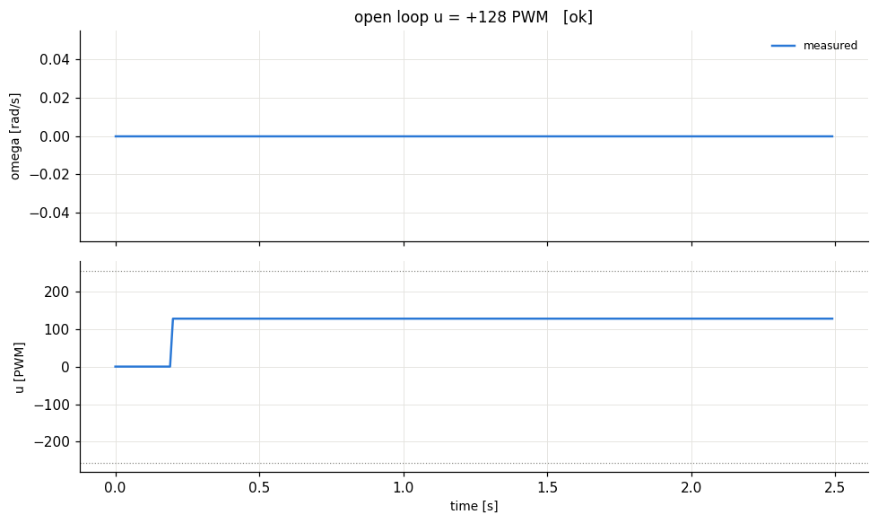
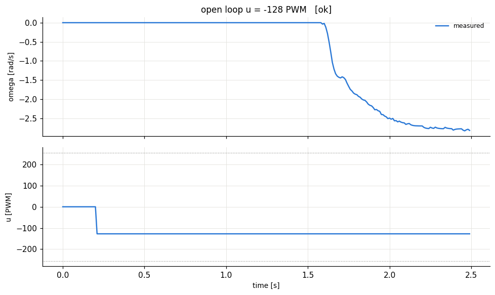

# check - HARDWARE run 20261021_133704

## Checks

| check | measured | result |
|---|---|---|
| sample period | mean 10.00 ms, max 10.01 ms | PASS |
| velocity noise at rest | std 0.000 rad/s | info |
| potentiometer | 0.368 (0..1) | info - turn it and rerun to verify |
| u = +128 PWM | omega = +0.0 rad/s, d(theta) = +0.0 rad | FAIL - motor did not move (power supply? driver wiring? PIN_PWM?) |
| u = -128 PWM | omega = -2.7 rad/s, d(theta) = -2.1 rad | PASS |
