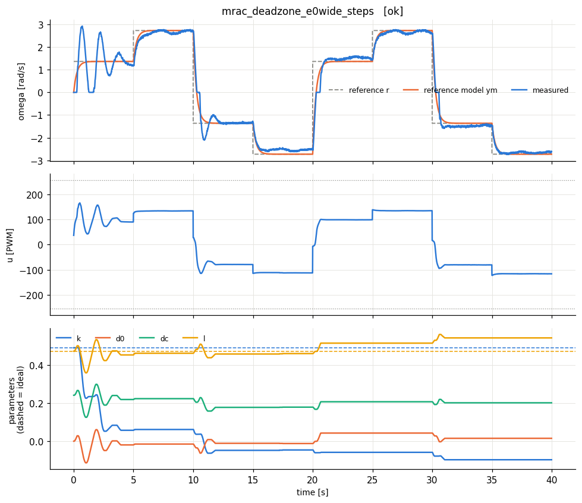
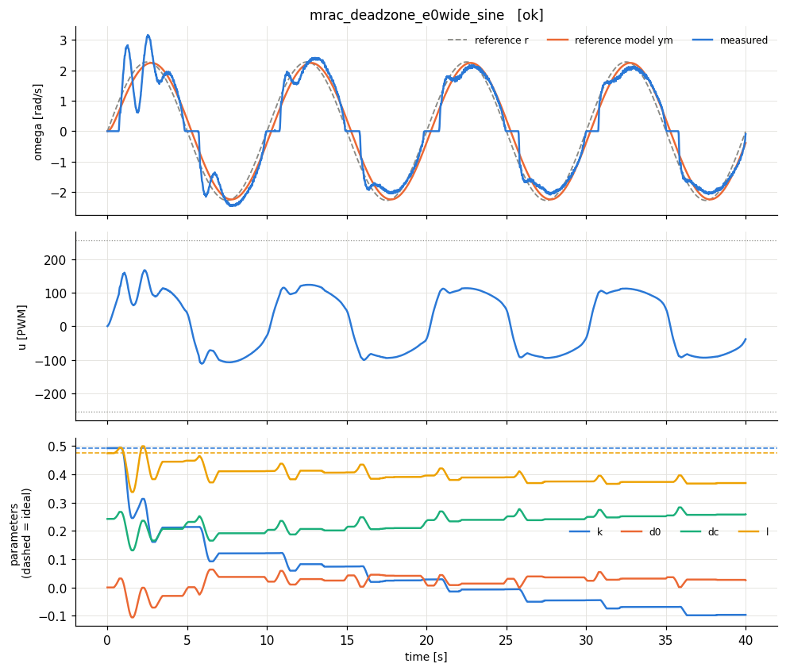
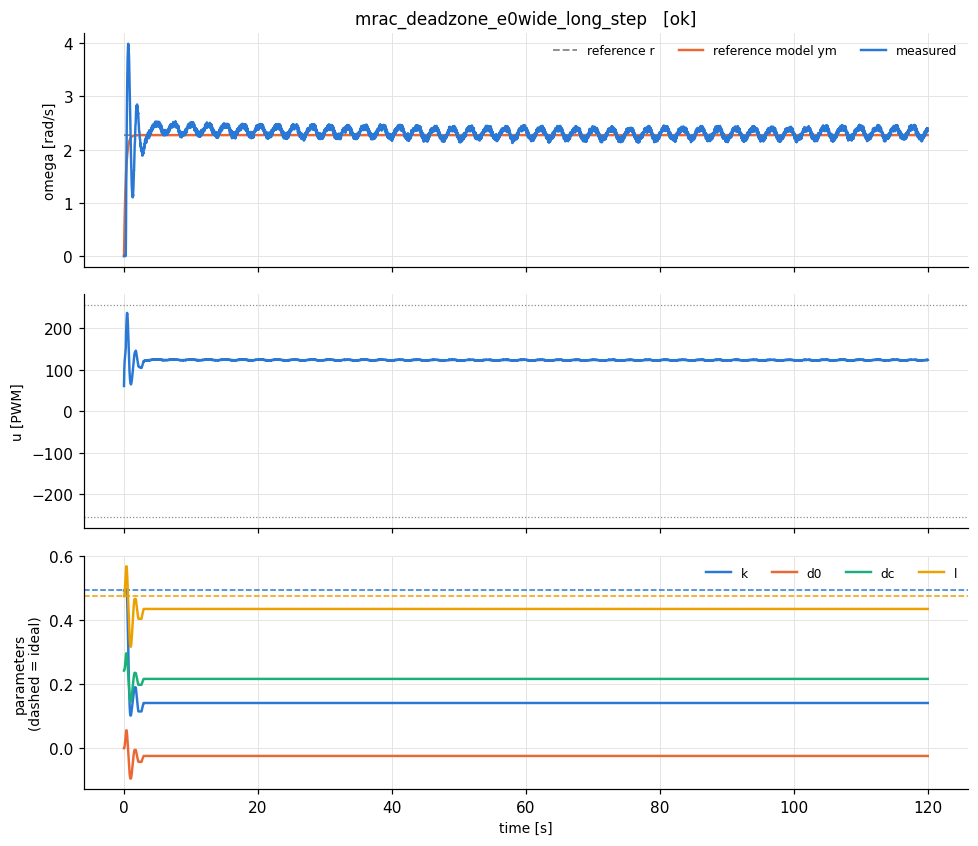
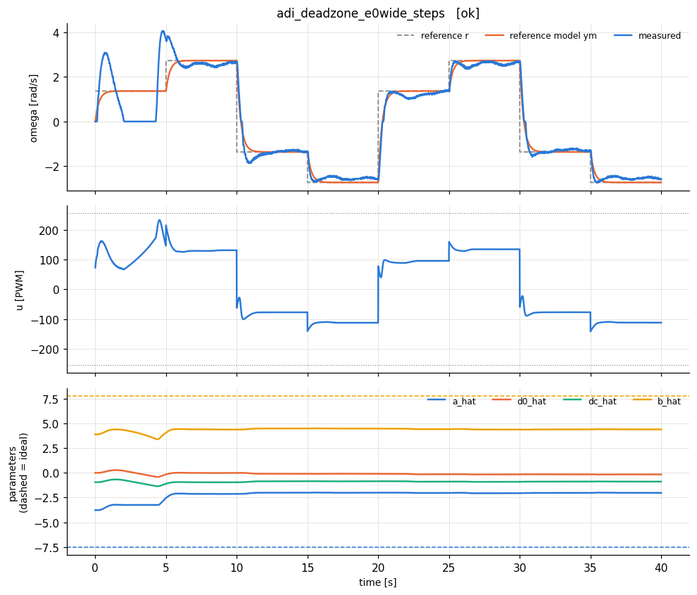
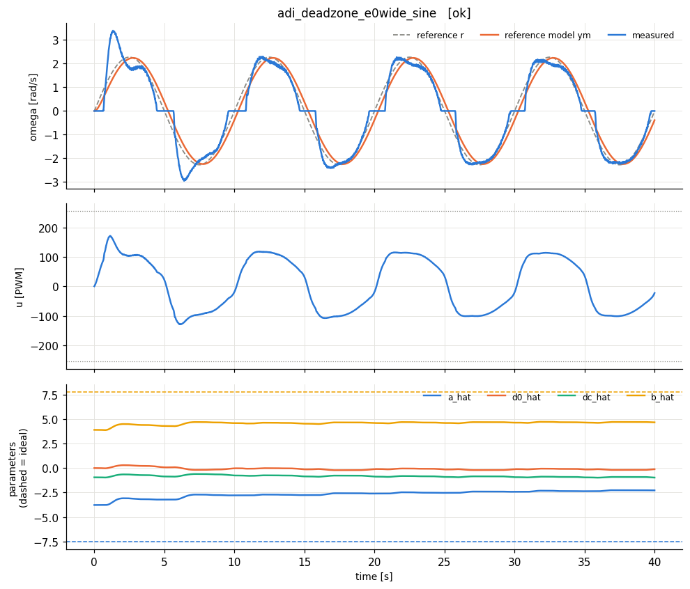
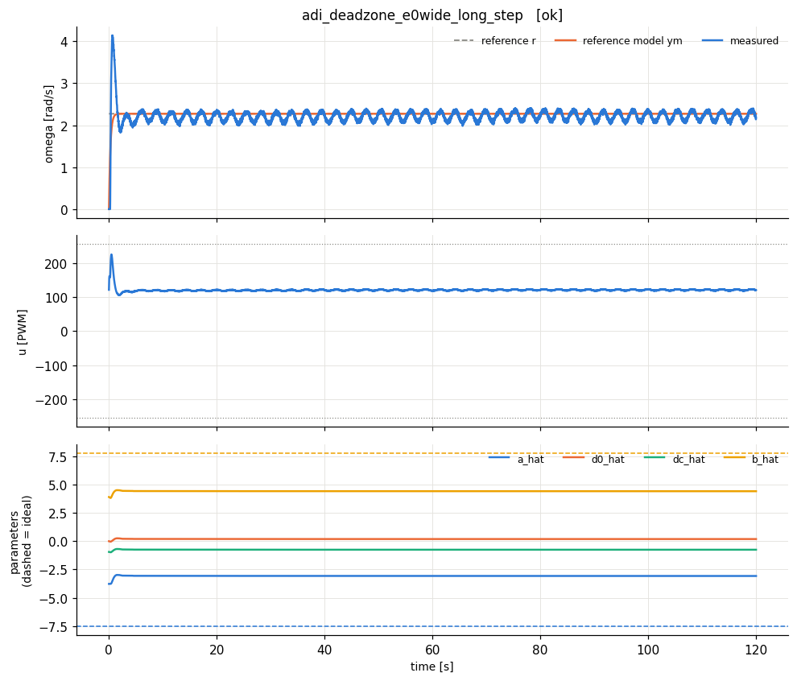

# extras_lab5dz - HARDWARE run 20261021_144555

Identified model: tau = 0.133 s (a = 7.55 1/s), K = 0.0185 rad/s/PWM, dead zone ~ 4 PWM, omega_max = 4.5 rad/s.

Normalised plant: dy/dt = -7.55 y + 7.81 u_n   (y = omega/4.5, u_n = u/255).

Reference model: dym/dt = -3.7 ym + 3.7 r  (time constant 0.27 s; open loop 0.133 s, dead time 0.09 s).

## Lab I.5 deadzone modification with e0 = 0.06 (was 0.02)

In Lab I.5 the deadzone e0 = 0.02 was below the velocity noise (|e| ~ 0.03-0.05), so adaptation never switched off and the ADI parameters kept drifting. Here e0 = 0.06; everything else as in Lab I.5.

| experiment | verdict | RMS e (norm) | RMS e last 25% | PE level | param drift (2nd half) | final params (ideal) |
|---|---|---|---|---|---|---|
| mrac_deadzone_e0wide_steps | OK | 0.0708 | 0.036 | 0.00067 | 0.101 | k=-0.0978 (0.492), d0=0.0151, dc=0.202, l=0.544 (0.474) |
| mrac_deadzone_e0wide_sine | OK | 0.0729 | 0.0478 | 0.00231 | 0.127 | k=-0.0967 (0.492), d0=0.0257, dc=0.258, l=0.369 (0.474) |
| mrac_deadzone_e0wide_long_step | OK | 0.0353 | 0.0189 | -1.2e-14 | 0 | k=0.141 (0.492), d0=-0.0239, dc=0.216, l=0.434 (0.474) |
| adi_deadzone_e0wide_steps | OK | 0.122 | 0.0396 | 0.00037 | 0.106 | a_hat=-2.02 (-7.55), d0_hat=-0.157, dc_hat=-0.884, b_hat=4.4 (7.81) |
| adi_deadzone_e0wide_sine | poor tracking | 0.105 | 0.0708 | 0.0013 | 0.342 | a_hat=-2.28 (-7.55), d0_hat=-0.115, dc_hat=-0.97, b_hat=4.67 (7.81) |
| adi_deadzone_e0wide_long_step | OK | 0.0416 | 0.025 | -1.11e-14 | 0.00172 | a_hat=-3.07 (-7.55), d0_hat=0.191, dc_hat=-0.752, b_hat=4.42 (7.81) |

**How to read the table.** *RMS e* is the normalised tracking error y - ym (0.01 = 1 % of omega_max). *PE level* = worst-case lambda_min/lambda_max of the windowed regressor covariance (≈0: not persistently exciting -> parameters need not converge to the ideal values; > ~0.01: PE holds -> parameters should approach the dashed ideal lines). *param drift* = largest parameter change during the second half of the run (large on a constant reference = parameter drift, the precursor of bursting/instability).
