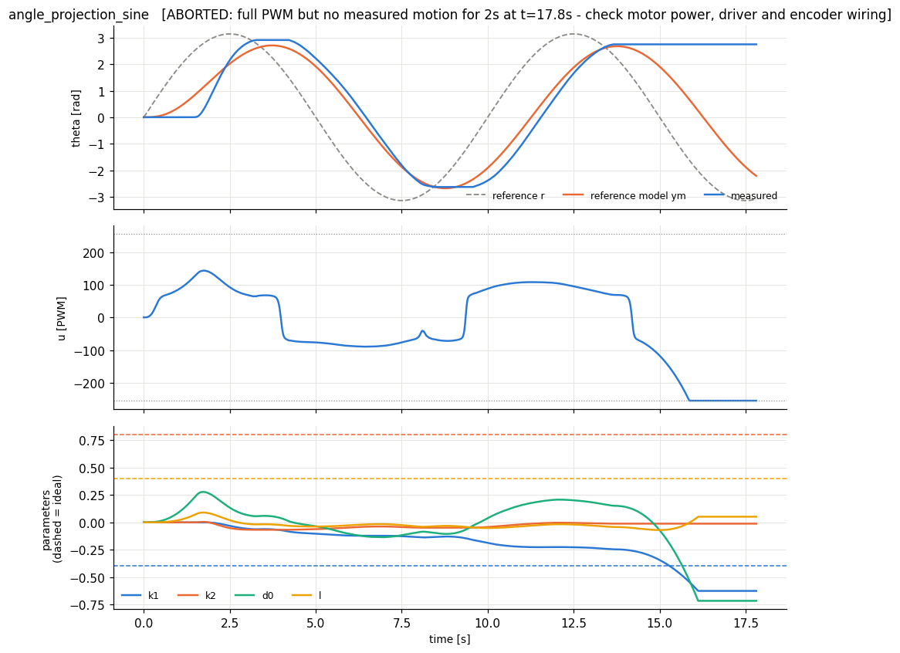

# extras_lab6rest - HARDWARE run 20261021_141201

## Lab I.6: remaining runs and sigma-modification toward nominal values

Same design as Lab I.6 (wn = 1.5 rad/s, zeta = 1, gamma = 5.0, dead-zone inverse 61.7 PWM, model results/rig/model.json). Ideal: k1* = -0.398, k2* = 0.805, l* = 0.398.

`sigma_nominal`: the estimates START at the nominal model values and sigma-modification leaks toward them (theta0 = nominal) instead of toward 0, as in Lab I.5.

**LAB STOPPED - hardware fault:** angle_projection_sine: ABORTED: full PWM but no measured motion for 2s at t=17.8s - check motor power, driver and encoder wiring. Runs after this one were not done.

| experiment | verdict | RMS e (norm) | RMS e last 25% | PE level | param drift (2nd half) | final params (ideal) | RMS angle error last 25% [rad] |
|---|---|---|---|---|---|---|---|

**How to read the table.** *RMS e* is the normalised tracking error y - ym (0.01 = 1 % of omega_max). *PE level* = worst-case lambda_min/lambda_max of the windowed regressor covariance (≈0: not persistently exciting -> parameters need not converge to the ideal values; > ~0.01: PE holds -> parameters should approach the dashed ideal lines). *param drift* = largest parameter change during the second half of the run (large on a constant reference = parameter drift, the precursor of bursting/instability). Here e is the filtered error e^T P B0 (normalised).
