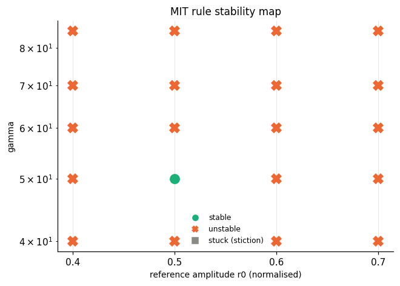

# extras_mitfine - HARDWARE run 20261021_142956

Identified model: tau = 0.133 s (a = 7.55 1/s), K = 0.0185 rad/s/PWM, dead zone ~ 4 PWM, omega_max = 4.5 rad/s.

Normalised plant: dy/dt = -7.55 y + 7.81 u_n   (y = omega/4.5, u_n = u/255).

Reference model: dym/dt = -3.7 ym + 3.7 r  (time constant 0.27 s; open loop 0.133 s, dead time 0.09 s).

## Finer MIT stability map around gamma*r0^2 ~ 15

gamma in [40.0, 50.0, 60.0, 70.0, 85.0], r0 in [0.4, 0.5, 0.6, 0.7] (normalised), square wave period 8 s, 24 s per run; same classification as Lab I.2 (runs abort once |theta| > 10.0).

| gamma | r0 (norm) | gamma*r0^2 | RMS e last 25% | verdict | status |
|---|---|---|---|---|---|
| 40 | 0.4 | 6.4 | 0.166 | UNSTABLE | ok |
| 40 | 0.5 | 10 | 0.314 | UNSTABLE | ok |
| 40 | 0.6 | 14.4 | 0.318 | UNSTABLE | ok |
| 40 | 0.7 | 19.6 | 0.386 | UNSTABLE | ok |
| 50 | 0.4 | 8 | 0.211 | UNSTABLE | ok |
| 50 | 0.5 | 12.5 | 0.114 | stable | ok |
| 50 | 0.6 | 18 | 0.424 | UNSTABLE | ok |
| 50 | 0.7 | 24.5 | 0.407 | UNSTABLE | ABORTED: adaptive parameters diverged at t=11.3s |
| 60 | 0.4 | 9.6 | 0.28 | UNSTABLE | ok |
| 60 | 0.5 | 15 | 0.288 | UNSTABLE | ok |
| 60 | 0.6 | 21.6 | 0.446 | UNSTABLE | ABORTED: adaptive parameters diverged at t=15.2s |
| 60 | 0.7 | 29.4 | 0.423 | UNSTABLE | ABORTED: adaptive parameters diverged at t=3.5s |
| 70 | 0.4 | 11.2 | 0.309 | UNSTABLE | ok |
| 70 | 0.5 | 17.5 | 0.394 | UNSTABLE | ABORTED: adaptive parameters diverged at t=11.5s |
| 70 | 0.6 | 25.2 | 0.456 | UNSTABLE | ABORTED: adaptive parameters diverged at t=7.3s |
| 70 | 0.7 | 34.3 | 0.578 | UNSTABLE | ABORTED: adaptive parameters diverged at t=1.8s |
| 85 | 0.4 | 13.6 | 0.348 | UNSTABLE | ok |
| 85 | 0.5 | 21.2 | 0.424 | UNSTABLE | ABORTED: adaptive parameters diverged at t=7.0s |
| 85 | 0.6 | 30.6 | 0.512 | UNSTABLE | ABORTED: adaptive parameters diverged at t=2.4s |
| 85 | 0.7 | 41.6 | 0.751 | UNSTABLE | ABORTED: adaptive parameters diverged at t=0.9s |

**Observed:** stable and unstable runs overlap in gamma*r0^2, so gamma*r0^2 alone does not explain the boundary here - inspect the plots (dead zone at small r0? saturation at large r0?).

