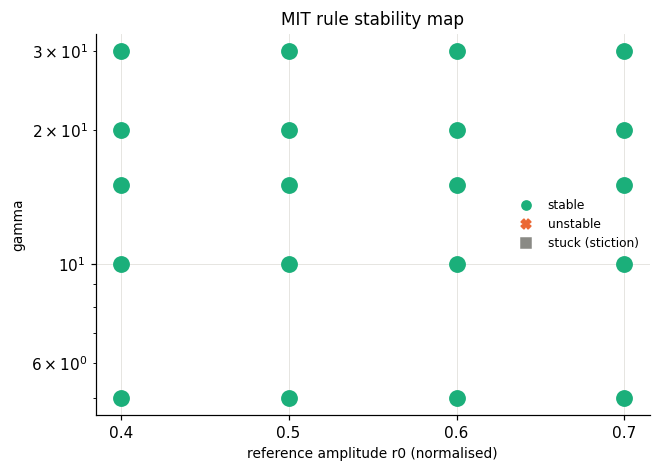

# extras_mitlow - HARDWARE run 20261021_143740

Identified model: tau = 0.133 s (a = 7.55 1/s), K = 0.0185 rad/s/PWM, dead zone ~ 4 PWM, omega_max = 4.5 rad/s.

Normalised plant: dy/dt = -7.55 y + 7.81 u_n   (y = omega/4.5, u_n = u/255).

Reference model: dym/dt = -3.7 ym + 3.7 r  (time constant 0.27 s; open loop 0.133 s, dead time 0.09 s).

## MIT stability map at low gamma (repaired motor)

On the repaired motor almost every run of the gamma = 40-85 sweep was unstable, so the boundary lies lower. gamma in [5.0, 10.0, 15.0, 20.0, 30.0], r0 in [0.4, 0.5, 0.6, 0.7]; same classification as Lab I.2.

| gamma | r0 (norm) | gamma*r0^2 | RMS e last 25% | verdict | status |
|---|---|---|---|---|---|
| 5 | 0.4 | 0.8 | 0.0544 | stable | ok |
| 5 | 0.5 | 1.25 | 0.0497 | stable | ok |
| 5 | 0.6 | 1.8 | 0.0496 | stable | ok |
| 5 | 0.7 | 2.45 | 0.06 | stable | ok |
| 10 | 0.4 | 1.6 | 0.0477 | stable | ok |
| 10 | 0.5 | 2.5 | 0.0493 | stable | ok |
| 10 | 0.6 | 3.6 | 0.059 | stable | ok |
| 10 | 0.7 | 4.9 | 0.0629 | stable | ok |
| 15 | 0.4 | 2.4 | 0.0441 | stable | ok |
| 15 | 0.5 | 3.75 | 0.0506 | stable | ok |
| 15 | 0.6 | 5.4 | 0.059 | stable | ok |
| 15 | 0.7 | 7.35 | 0.0635 | stable | ok |
| 20 | 0.4 | 3.2 | 0.0336 | stable | ok |
| 20 | 0.5 | 5 | 0.0514 | stable | ok |
| 20 | 0.6 | 7.2 | 0.0578 | stable | ok |
| 20 | 0.7 | 9.8 | 0.06 | stable | ok |
| 30 | 0.4 | 4.8 | 0.0427 | stable | ok |
| 30 | 0.5 | 7.5 | 0.0474 | stable | ok |
| 30 | 0.6 | 10.8 | 0.0662 | stable | ok |
| 30 | 0.7 | 14.7 | 0.0725 | stable | ok |

No instability in the tested range - extend MIT_GAMMA_SWEEP in lab/config.py.

