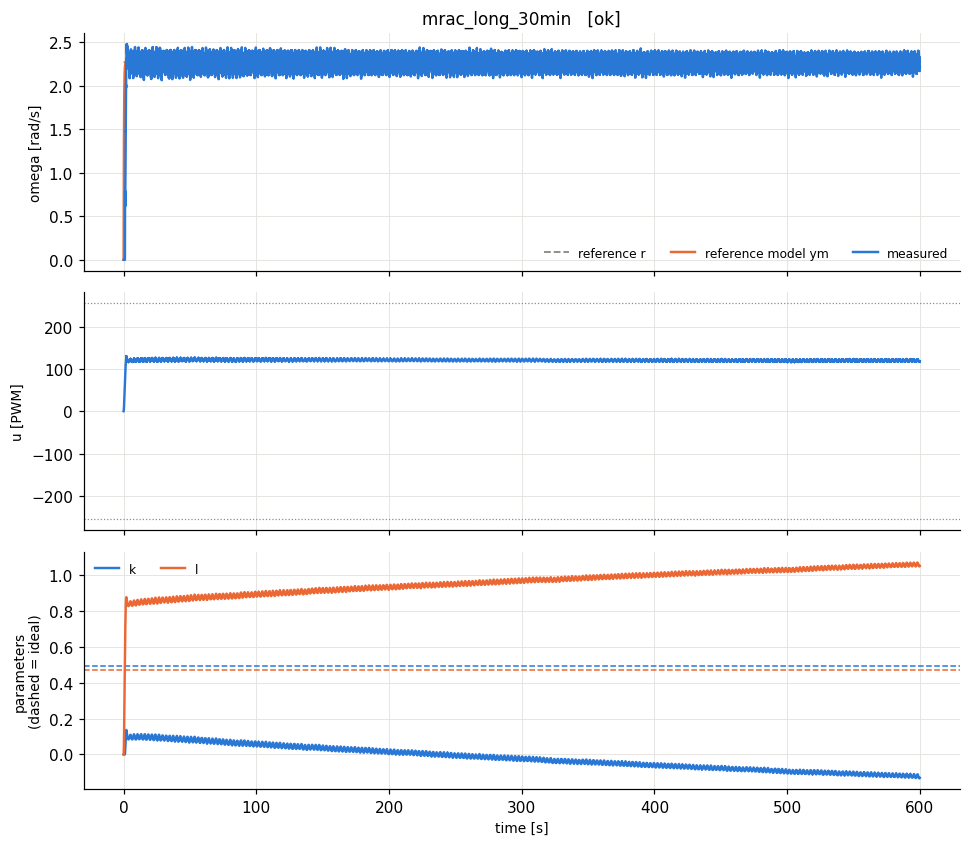

# extras_mraclong - HARDWARE run 20261021_145241

Identified model: tau = 0.133 s (a = 7.55 1/s), K = 0.0185 rad/s/PWM, dead zone ~ 4 PWM, omega_max = 4.5 rad/s.

Normalised plant: dy/dt = -7.55 y + 7.81 u_n   (y = omega/4.5, u_n = u/255).

Reference model: dym/dt = -3.7 ym + 3.7 r  (time constant 0.27 s; open loop 0.133 s, dead time 0.09 s).

## Plain scalar MRAC (Lab I.3) on a 10 min constant step

gamma = 3.0, estimates start at 0, reference 0.5 omega_max. Question: does the linear parameter drift seen in the 10 min run of Lab I.3 keep growing, saturate, or end in a burst?

| experiment | verdict | RMS e (norm) | RMS e last 25% | PE level | param drift (2nd half) | final params (ideal) |
|---|---|---|---|---|---|---|
| mrac_long_10min | OK | 0.0246 | 0.0141 | 0.000173 | 0.122 | k=-0.13 (0.492), l=1.05 (0.474) |

| time | k | l | RMS e (last 30 s) |
|---|---|---|---|
| 1 min | 0.065 | 0.865 | 0.0182 |
| 5 min | -0.016 | 0.980 | 0.0160 |
