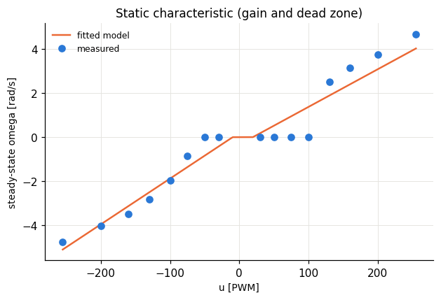
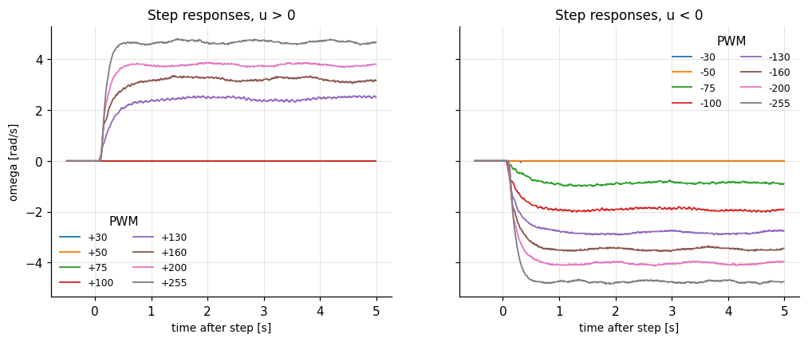
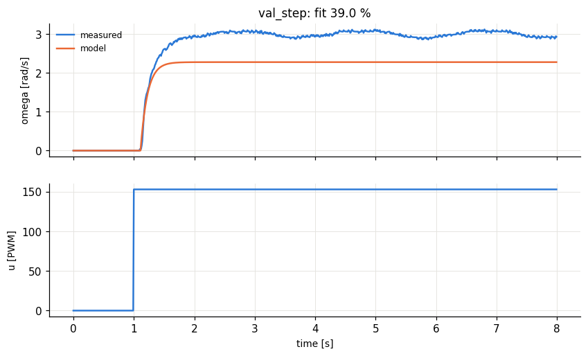
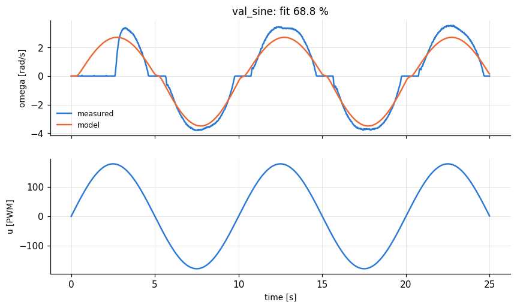
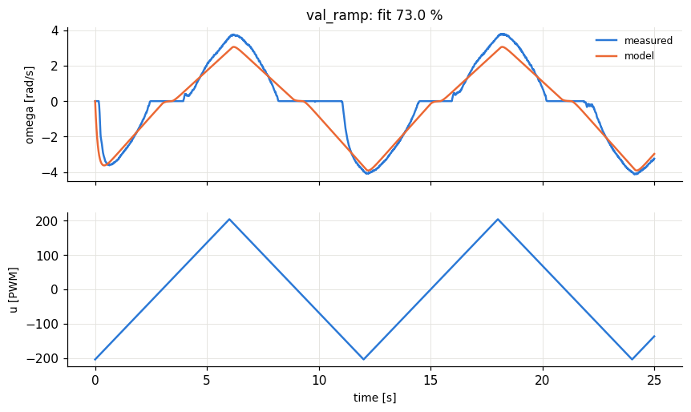
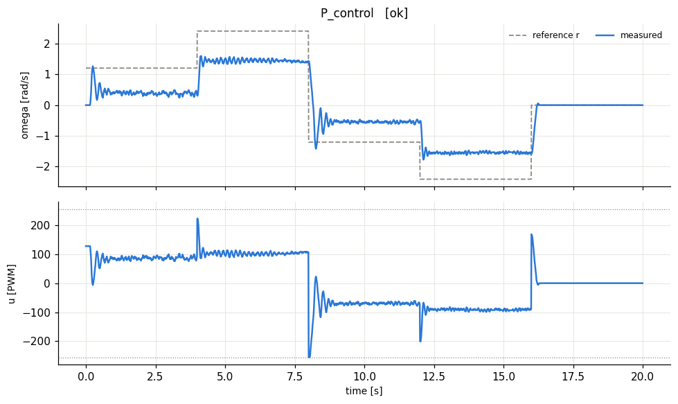
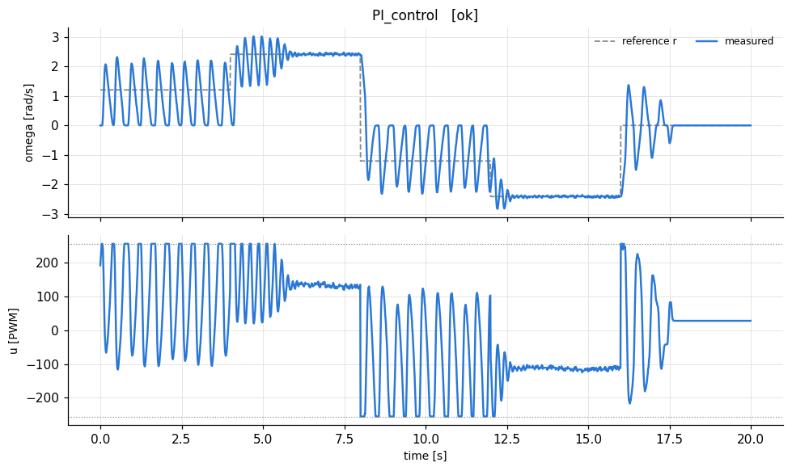

# lab1_identification - HARDWARE run 20261014_134803

## A. Step tests: steady-state gain and time constant

| u [PWM] | omega_ss [rad/s] | model omega_ss | dead time Td [s] | tau (63%) - Td [s] | rise 10-90% [s] | settled? |
|---|---|---|---|---|---|---|
| 30 | 0 | 0.181 | 0 | 0 | 0 | yes |
| 50 | 0 | 0.522 | 4e-06 | 0 | 0 | yes |
| 75 | 0 | 0.949 | 4e-06 | 0 | 0 | yes |
| 100 | 0 | 1.38 | 0 | 0 | 0 | yes |
| 130 | 2.51 | 1.89 | 0.09 | 0.23 | 0.56 | yes |
| 160 | 3.13 | 2.4 | 0.11 | 0.13 | 0.38 | yes |
| 200 | 3.74 | 3.09 | 0.11 | 0.11 | 0.25 | yes |
| 255 | 4.68 | 4.02 | 0.12 | 0.09 | 0.19 | yes |
| -30 | 0 | -0.423 | 4e-06 | 0 | 0 | yes |
| -50 | 0 | -0.838 | 0 | 0 | 0 | yes |
| -75 | -0.86 | -1.36 | 0.08 | 0.3 | 0.46 | yes |
| -100 | -1.95 | -1.88 | 0.08 | 0.19 | 0.51 | yes |
| -130 | -2.81 | -2.5 | 0.1 | 0.15 | 0.42 | yes |
| -160 | -3.49 | -3.12 | 0.11 | 0.13 | 0.37 | yes |
| -200 | -4.04 | -3.95 | 0.11 | 0.12 | 0.31 | yes |
| -255 | -4.76 | -5.1 | 0.13 | 0.1 | 0.24 | yes |

Identified parameters (tau = median over steps outside the dead zone; for a first-order system rise_10_90 ~ 2.2*tau is a consistency check):

|  | u > 0 | u < 0 | average (used for design) |
|---|---|---|---|
| gain K [rad/s/PWM] | 0.0171 | 0.0208 | 0.0189 |
| dead zone u0 [PWM] | 19.4 | 9.64 |  |
| time constant tau [s] | 0.12 | 0.13 | 0.125 |
| pole a = 1/tau [1/s] | 8.33 | 7.69 | 8 |
| dead time Td [s] |  |  | 0.11 |
| b = a*K |  |  | 0.151 |
| omega_max [rad/s] |  |  | 4.02 |

Model saved to `/home/stathisliap/HMTY/Adaptive_Control/results/rig/model.json`

## B. Model validation

fit % = 100 * (1 - ||omega - omega_model|| / ||omega - mean(omega)||).  Above ~80 % the first-order model is good.

| input | fit % | RMS error [rad/s] |
|---|---|---|
| val_step | 39 | 0.647 |
| val_sine | 68.8 | 0.728 |
| val_ramp | 73 | 0.601 |

## C. P and PI velocity control designed from the model

- P:  Kp = (speedup-1)*a/b = **105.7**  -> closed-loop tau = 0.0417 s, predicted steady-state ratio omega/r = 0.667
- PI: Kp = speedup*a/b = **158.5**, Ki = Kp*a = **1268** (zero cancels the motor pole) -> closed-loop tau = 0.0417 s, zero steady-state error

| controller | measured omega/r at steady state | RMS error [rad/s] |
|---|---|---|
| P_control | 0.501 | 0.789 |
| PI_control | 0.892 | 0.695 |

(Predicted ratio: P = 0.667, PI = 1.000. The dead zone lowers the P ratio further.)
