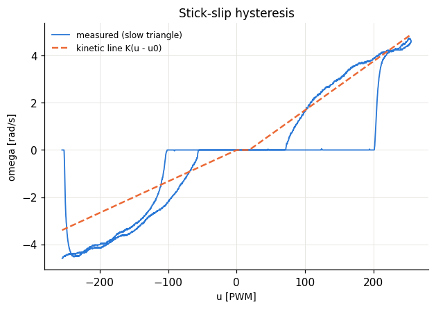
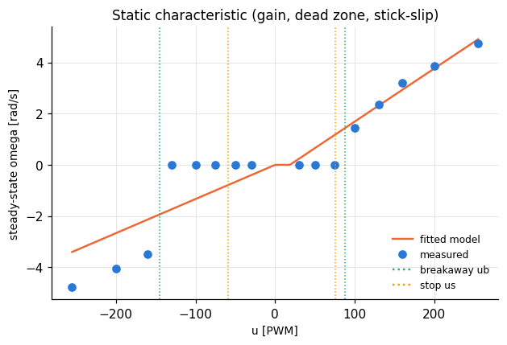
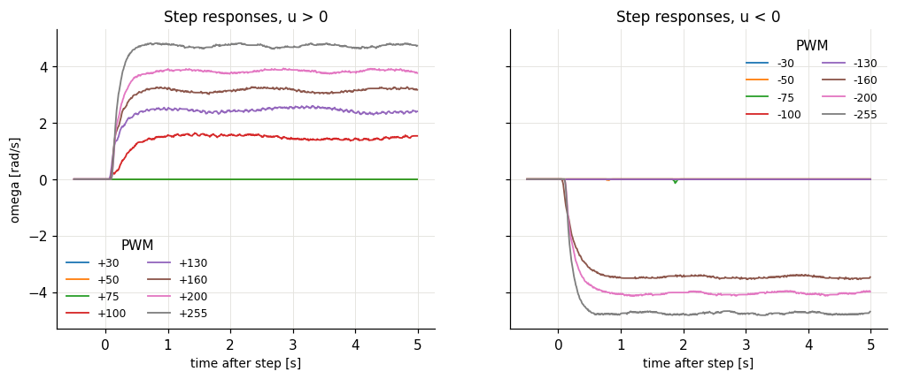
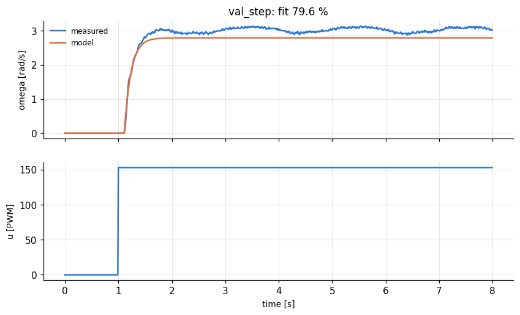
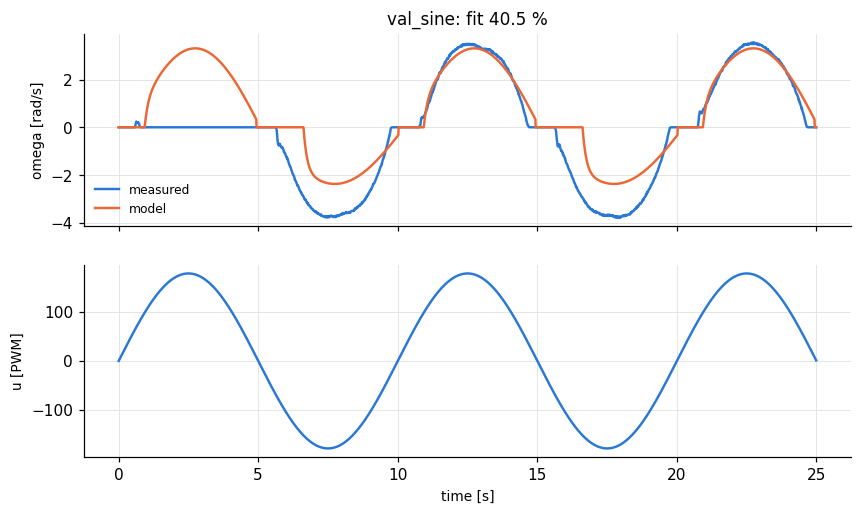
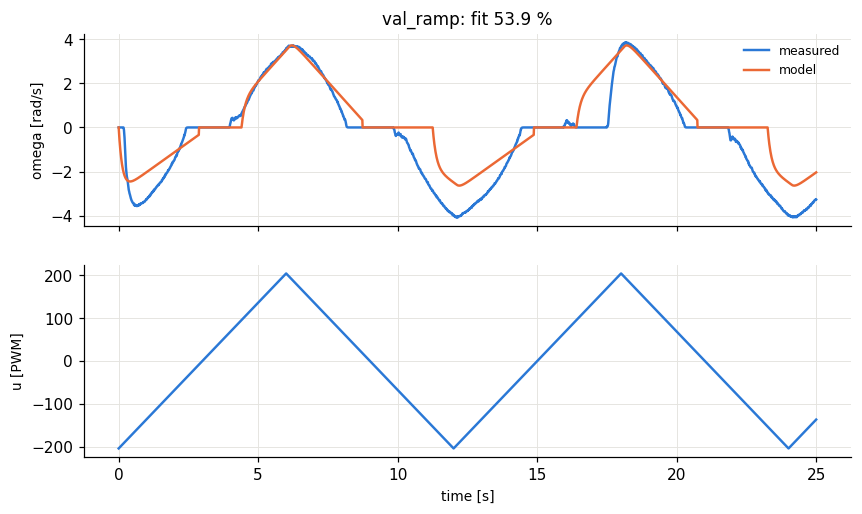
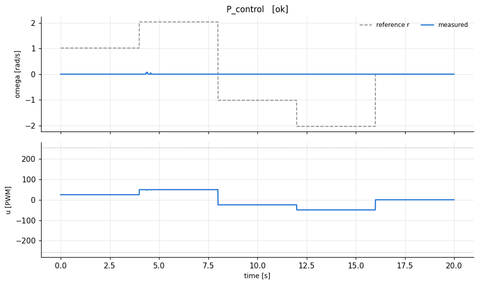
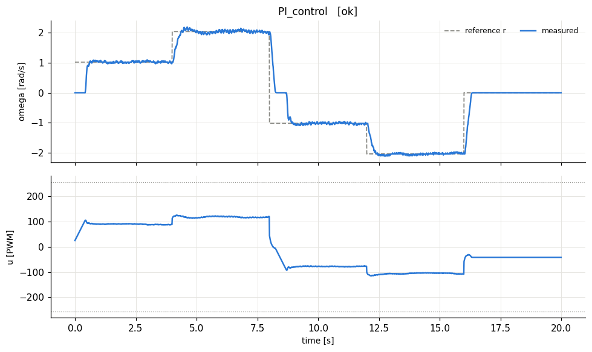

# lab1_identification - HARDWARE run 20261014_135426

## A. Step tests: steady-state gain and time constant

| u [PWM] | omega_ss [rad/s] | model omega_ss | dead time Td [s] | tau (63%) - Td [s] | rise 10-90% [s] | settled? |
|---|---|---|---|---|---|---|
| 30 | 0 | 0.24 | 0 | 0 | 0 | yes |
| 50 | 0 | 0.654 | 0 | 0 | 0 | yes |
| 75 | 0 | 1.17 | 0 | 0 | 0 | yes |
| 100 | 1.45 | 1.69 | 0.09 | 0.26 | 0.44 | yes |
| 130 | 2.36 | 2.31 | 0.08 | 0.13 | 0.27 | yes |
| 160 | 3.2 | 2.93 | 0.1 | 0.14 | 0.32 | yes |
| 200 | 3.86 | 3.76 | 0.11 | 0.13 | 0.3 | yes |
| 255 | 4.73 | 4.9 | 0.12 | 0.09 | 0.22 | yes |
| -30 | 0 | -0.4 | 0 | 0 | 0 | yes |
| -50 | 0 | -0.666 | 0 | 0 | 0 | yes |
| -75 | 0 | -1 | 0 | 0 | 0 | yes |
| -100 | 0 | -1.33 | 4e-06 | 0 | 0 | yes |
| -130 | 0 | -1.73 | 0 | 0 | 0 | yes |
| -160 | -3.49 | -2.13 | 0.08 | 0.17 | 0.42 | yes |
| -200 | -4.06 | -2.67 | 0.12 | 0.13 | 0.33 | yes |
| -255 | -4.76 | -3.4 | 0.12 | 0.1 | 0.24 | yes |

Identified parameters (tau = median over the moving steps; for a first-order system rise_10_90 ~ 2.2*tau is a consistency check). ub > us means stick-slip hysteresis: the shaft needs more PWM to start than to keep moving.

|  | u > 0 | u < 0 | average (used for design) |
|---|---|---|---|
| gain K [rad/s/PWM] | 0.0207 | 0.0133 | 0.017 |
| dead zone u0 of the kinetic line [PWM] | 18.4 | 0 |  |
| breakaway from rest ub (steps) [PWM] | 87.5 | 145 |  |
| breakaway from rest (slow triangle) [PWM] | 199 | 177 |  |
| stop threshold us (slow triangle) [PWM] | 75.2 | 59.4 |  |
| time constant tau [s] | 0.13 | 0.13 | 0.13 |
| pole a = 1/tau [1/s] | 7.69 | 7.69 | 7.69 |
| dead time Td [s] |  |  | 0.105 |
| b = a*K |  |  | 0.131 |
| omega_max [rad/s] |  |  | 3.4 |

Model saved to `/home/stathisliap/HMTY/Adaptive_Control/results/rig/model.json`

## B. Model validation

Model = first order + dead time + stick-slip. fit % = 100 * (1 - ||omega - omega_model|| / ||omega - mean(omega)||); above ~80 % is good.

| input | fit % | RMS error [rad/s] |
|---|---|---|
| val_step | 79.6 | 0.217 |
| val_sine | 40.5 | 1.31 |
| val_ramp | 53.9 | 1.01 |

## C. P and PI velocity control designed from the model

Plant: K = 0.01702 rad/s/PWM, tau = 0.13 s, dead time Td = 0.105 s. Lambda tuning: lambda = max(tau/speedup, 2*Td).

- P:  Kp = tau/(K(lambda+Td)) = **24.24** (lambda = 0.21 s), predicted steady-state ratio omega/r = K Kp/(1 + K Kp) = 0.292
- PI: Kp = tau/(K(lambda+Td)) = **24.24**, Ki = Kp/tau = **186.5** (lambda = 0.21 s), zero steady-state error

Small references sit inside the stick-slip band, so expect stick-slip cycling there: the controller must build up ~ub PWM to break away, then the shaft overshoots and sticks again.

| controller | measured omega/r at steady state | RMS error [rad/s] |
|---|---|---|
| P_control | 0 | 1.44 |
| PI_control | 1 | 0.39 |

(Predicted ratio: P = 0.292, PI = 1.000. The dead zone lowers the P ratio further.)
