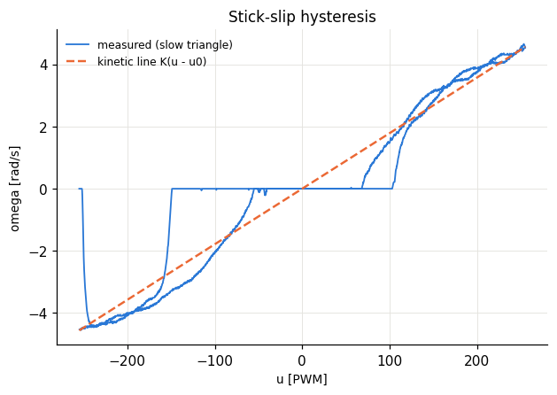
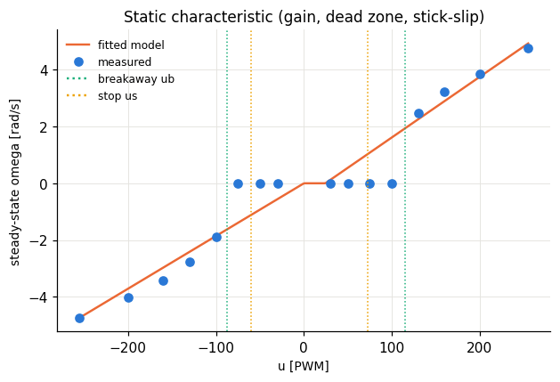
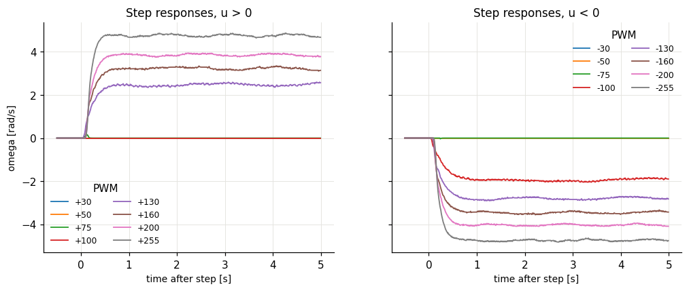
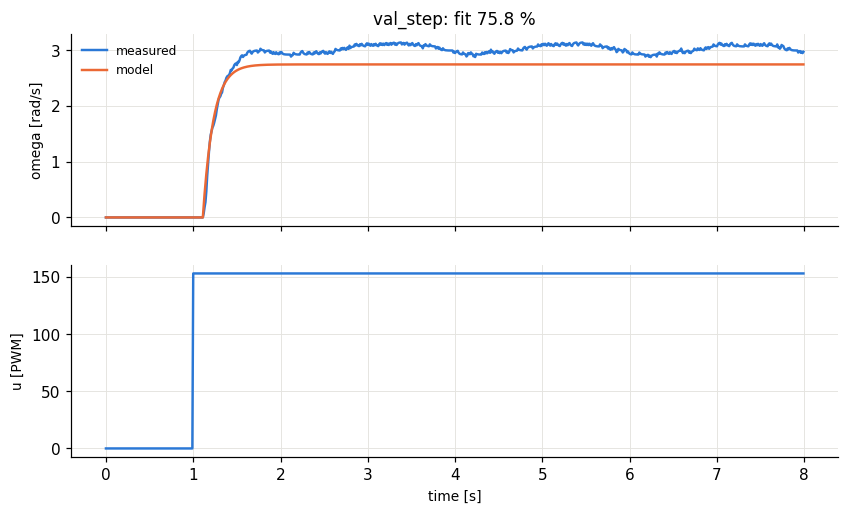
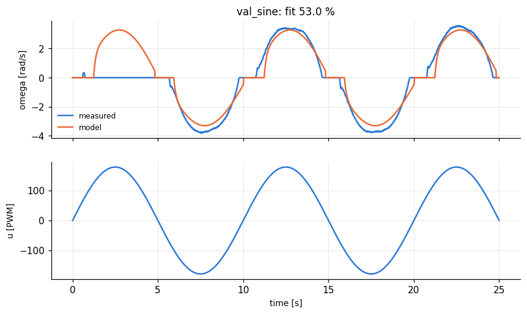
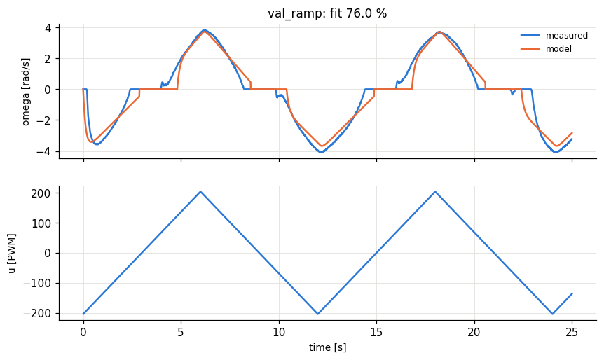
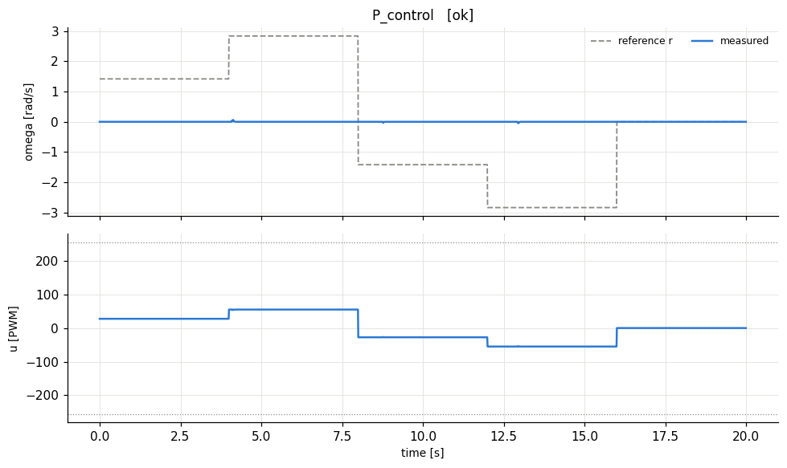
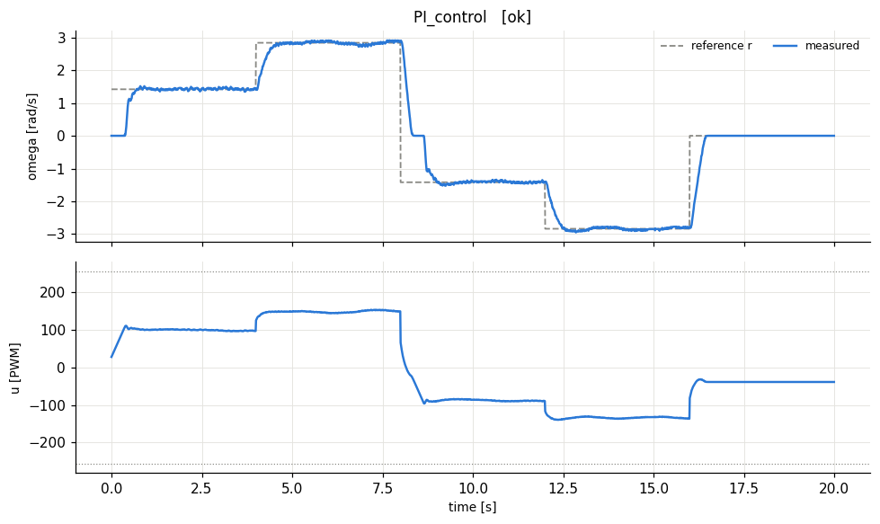

# lab1_identification - HARDWARE run 20261014_135918

## A. Step tests: steady-state gain and time constant

| u [PWM] | omega_ss [rad/s] | model omega_ss | dead time Td [s] | tau (63%) - Td [s] | rise 10-90% [s] | settled? |
|---|---|---|---|---|---|---|
| 30 | 0 | 0.12 | 4e-06 | 0 | 0 | yes |
| 50 | 0 | 0.547 | 4e-06 | 0 | 0 | yes |
| 75 | 0 | 1.08 | 0 | 0 | 0 | yes |
| 100 | 0 | 1.61 | 4e-06 | 0 | 0 | yes |
| 130 | 2.47 | 2.25 | 0.07 | 0.17 | 0.37 | yes |
| 160 | 3.23 | 2.9 | 0.11 | 0.13 | 0.31 | yes |
| 200 | 3.85 | 3.75 | 0.12 | 0.12 | 0.27 | yes |
| 255 | 4.77 | 4.92 | 0.12 | 0.1 | 0.21 | yes |
| -30 | 0 | -0.557 | 4e-06 | 0 | 0 | yes |
| -50 | 0 | -0.928 | 4e-06 | 0 | 0 | yes |
| -75 | 0 | -1.39 | 4e-06 | 0 | 0 | yes |
| -100 | -1.88 | -1.86 | 0.07 | 0.22 | 0.46 | yes |
| -130 | -2.76 | -2.41 | 0.1 | 0.14 | 0.36 | yes |
| -160 | -3.43 | -2.97 | 0.11 | 0.13 | 0.3 | yes |
| -200 | -4.02 | -3.71 | 0.12 | 0.11 | 0.27 | yes |
| -255 | -4.73 | -4.73 | 0.13 | 0.1 | 0.22 | yes |

Identified parameters. Kinetic line omega = K(u - u0) from all moving samples of the slow triangle; tau and Td = medians over the moving steps (rise_10_90 ~ 2.2*tau is a consistency check). ub > us means stick-slip hysteresis: the shaft needs more PWM to start than to keep moving. Breakaway varies from one start to the next (shaft position, gearbox), compare the two ub rows.

|  | u > 0 | u < 0 | average (used for design) |
|---|---|---|---|
| gain K, slow triangle (used) [rad/s/PWM] | 0.0213 | 0.0186 | 0.0199 |
| gain K, steps (cross-check) | 0.0179 | 0.0179 |  |
| dead zone u0 of the kinetic line [PWM] | 24.4 | 0 |  |
| breakaway from rest ub (steps) [PWM] | 115 | 87.5 |  |
| breakaway from rest (slow triangle) [PWM] | 103 | 201 |  |
| stop threshold us (slow triangle) [PWM] | 72.7 | 59.9 |  |
| time constant tau [s] | 0.125 | 0.13 | 0.127 |
| pole a = 1/tau [1/s] | 8 | 7.69 | 7.84 |
| dead time Td [s] |  |  | 0.11 |
| b = a*K |  |  | 0.156 |
| omega_max [rad/s] |  |  | 4.73 |

Model saved to `/home/stathisliap/HMTY/Adaptive_Control/results/rig/model.json`

## B. Model validation

Model = first order + dead time + stick-slip. fit % = 100 * (1 - ||omega - omega_model|| / ||omega - mean(omega)||); above ~80 % is good.

| input | fit % | fit % while both moving | RMS error [rad/s] |
|---|---|---|---|
| val_step | 75.8 | 0.0366 | 0.259 |
| val_sine | 53 | 87.4 | 1.04 |
| val_ramp | 76 | 86 | 0.533 |

*fit while moving* judges the dynamic model (gain, tau, Td) without the random breakaway instants.

## C. P and PI velocity control designed from the model

Plant: K = 0.01995 rad/s/PWM, tau = 0.127 s, dead time Td = 0.11 s. Lambda tuning: lambda = max(tau/speedup, 2*Td).

- P:  Kp = tau/(K(lambda+Td)) = **19.37** (lambda = 0.22 s), predicted steady-state ratio omega/r = K Kp/(1 + K Kp) = 0.279
- PI: Kp = tau/(K(lambda+Td)) = **19.37**, Ki = Kp/tau = **151.9** (lambda = 0.22 s), zero steady-state error

Small references sit inside the stick-slip band, so expect stick-slip cycling there: the controller must build up ~ub PWM to break away, then the shaft overshoots and sticks again.

| controller | measured omega/r at steady state | RMS error [rad/s] |
|---|---|---|
| P_control | 0 | 2.01 |
| PI_control | 1 | 0.58 |

(Predicted ratio: P = 0.279, PI = 1.000. The dead zone lowers the P ratio further.)
