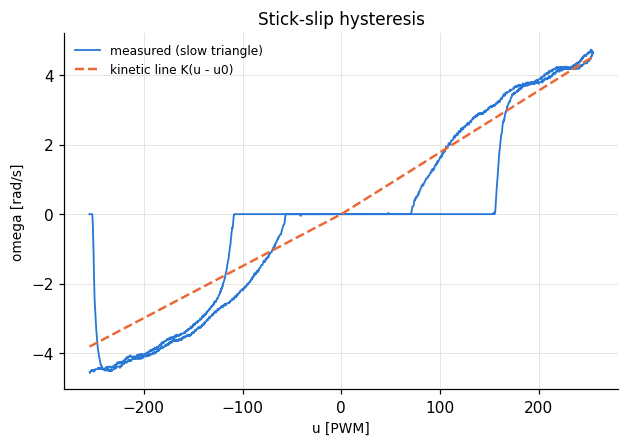
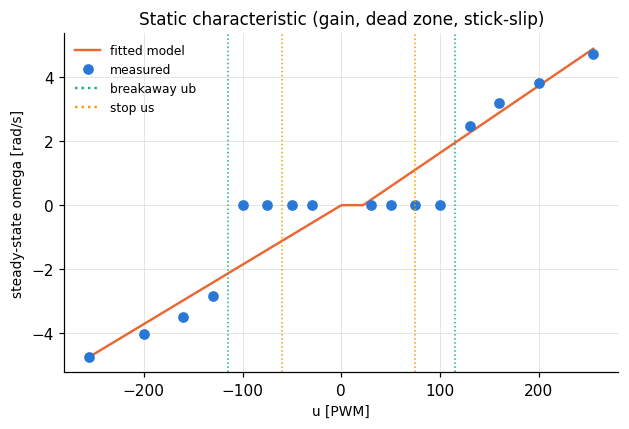
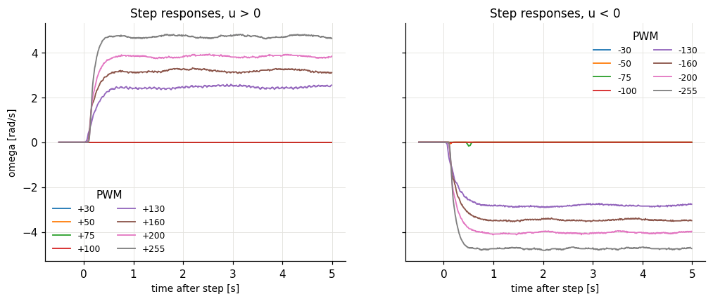
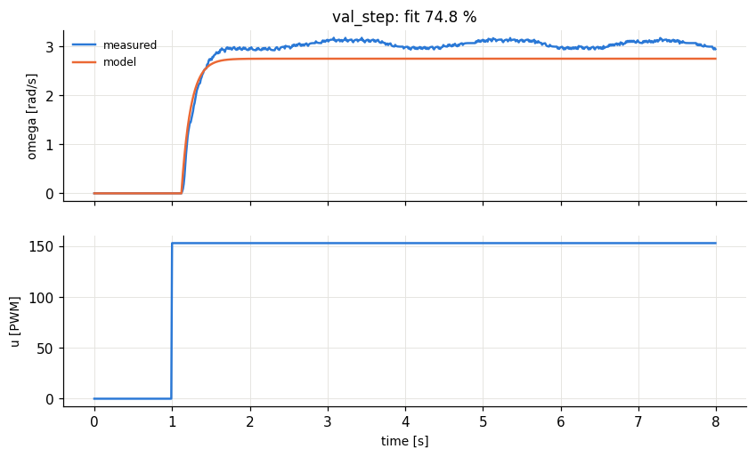
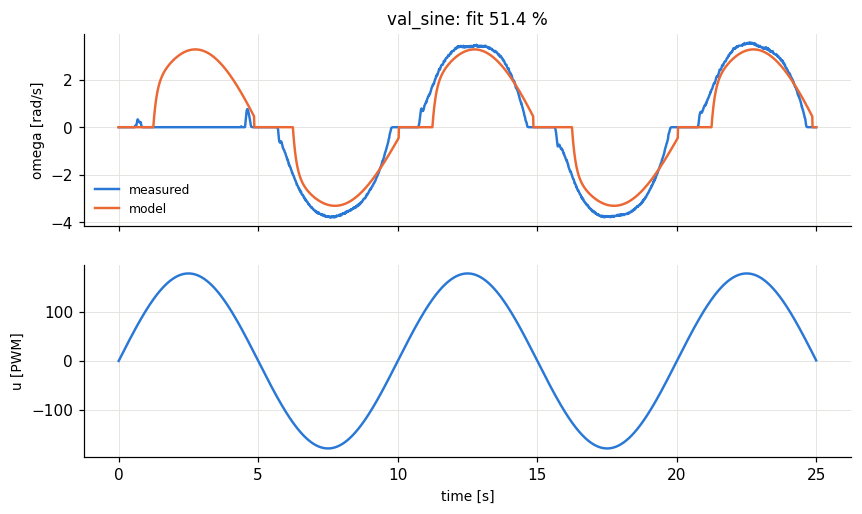
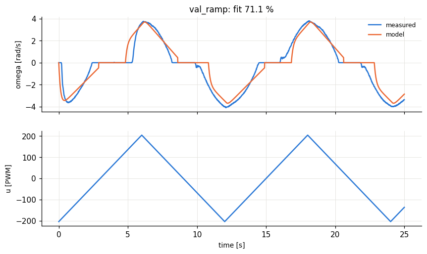
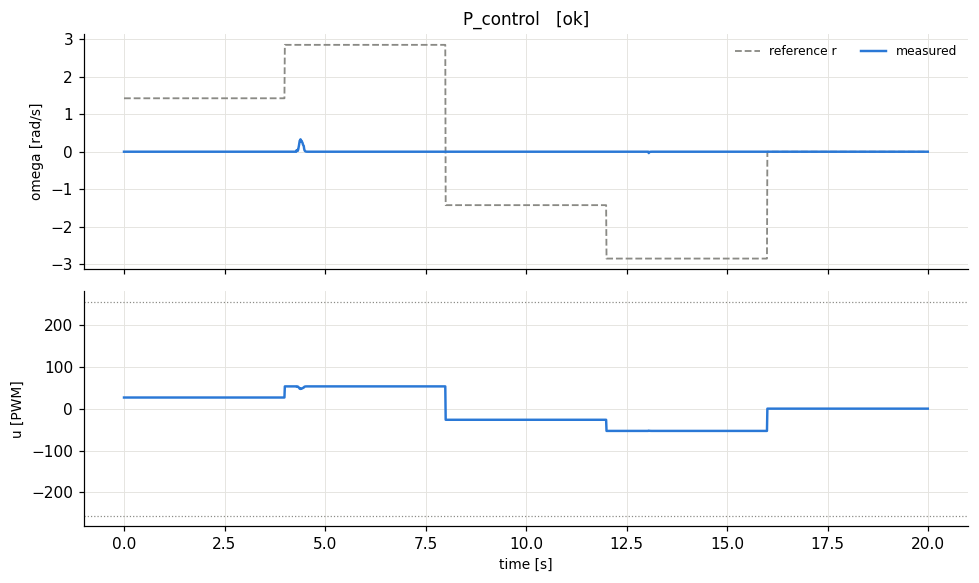
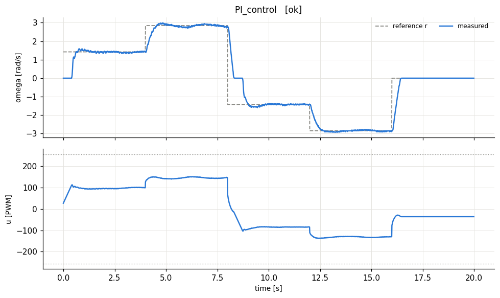

# lab1_identification - HARDWARE run 20261014_142130

## A. Step tests: steady-state gain and time constant

| u [PWM] | omega_ss [rad/s] | model omega_ss | dead time Td [s] | tau (63%) - Td [s] | rise 10-90% [s] | settled? |
|---|---|---|---|---|---|---|
| 30 | 0 | 0.169 | 0 | 0 | 0 | yes |
| 50 | 0 | 0.589 | 0 | 0 | 0 | yes |
| 75 | 0 | 1.11 | 0 | 0 | 0 | yes |
| 100 | 0 | 1.64 | 0 | 0 | 0 | yes |
| 130 | 2.47 | 2.27 | 0.07 | 0.19 | 0.38 | yes |
| 160 | 3.19 | 2.9 | 0.1 | 0.13 | 0.3 | yes |
| 200 | 3.83 | 3.74 | 0.11 | 0.12 | 0.27 | yes |
| 255 | 4.74 | 4.89 | 0.12 | 0.09 | 0.2 | yes |
| -30 | 0 | -0.558 | 0 | 0 | 0 | yes |
| -50 | 0 | -0.93 | 0 | 0 | 0 | yes |
| -75 | 0 | -1.39 | 0 | 0 | 0 | yes |
| -100 | 0 | -1.86 | 4e-06 | 0 | 0 | yes |
| -130 | -2.83 | -2.42 | 0.08 | 0.17 | 0.39 | yes |
| -160 | -3.48 | -2.97 | 0.12 | 0.14 | 0.38 | yes |
| -200 | -4.04 | -3.72 | 0.12 | 0.12 | 0.29 | yes |
| -255 | -4.74 | -4.74 | 0.13 | 0.09 | 0.22 | yes |

Identified parameters. Kinetic line omega = K(u - u0) from all moving samples of the slow triangle; tau and Td = medians over the moving steps (rise_10_90 ~ 2.2*tau is a consistency check). ub > us means stick-slip hysteresis: the shaft needs more PWM to start than to keep moving. Breakaway varies from one start to the next (shaft position, gearbox), compare the two ub rows.

|  | u > 0 | u < 0 | average (used for design) |
|---|---|---|---|
| gain K, slow triangle (used) [rad/s/PWM] | 0.021 | 0.0186 | 0.0198 |
| gain K, steps (cross-check) | 0.0178 | 0.0149 |  |
| dead zone u0 of the kinetic line [PWM] | 21.9 | 0 |  |
| breakaway from rest ub (steps) [PWM] | 115 | 115 |  |
| breakaway from rest (slow triangle) [PWM] | 153 | 181 |  |
| stop threshold us (slow triangle) [PWM] | 74.7 | 60.2 |  |
| time constant tau [s] | 0.125 | 0.13 | 0.128 |
| pole a = 1/tau [1/s] | 8 | 7.69 | 7.84 |
| dead time Td [s] |  |  | 0.115 |
| b = a*K |  |  | 0.155 |
| omega_max [rad/s] |  |  | 4.74 |

Model saved to `/home/stathisliap/HMTY/Adaptive_Control/results/rig/model.json`

## B. Model validation

Model = first order + dead time + stick-slip. fit % = 100 * (1 - ||omega - omega_model|| / ||omega - mean(omega)||); above ~80 % is good.

| input | fit % | fit % while both moving | RMS error [rad/s] |
|---|---|---|---|
| val_step | 74.8 | n/a | 0.273 |
| val_sine | 51.4 | 85.1 | 1.09 |
| val_ramp | 71.1 | 83.2 | 0.647 |

*fit while moving* judges the dynamic model (gain, tau, Td) without the random breakaway instants.

## C. P and PI velocity control designed from the model

Plant: K = 0.01979 rad/s/PWM, tau = 0.128 s, dead time Td = 0.115 s. Lambda tuning: lambda = max(tau/speedup, 2*Td).

- P:  Kp = tau/(K(lambda+Td)) = **18.68** (lambda = 0.23 s), predicted steady-state ratio omega/r = K Kp/(1 + K Kp) = 0.270
- PI: Kp = tau/(K(lambda+Td)) = **18.68**, Ki = Kp/tau = **146.5** (lambda = 0.23 s), zero steady-state error

Small references sit inside the stick-slip band, so expect stick-slip cycling there: the controller must build up ~ub PWM to break away, then the shaft overshoots and sticks again.

| controller | measured omega/r at steady state | RMS error [rad/s] |
|---|---|---|
| P_control | 0 | 2.01 |
| PI_control | 0.998 | 0.584 |

(Predicted ratio: P = 0.270, PI = 1.000. If the P output K_p*e stays below the breakaway PWM ub, the shaft never starts (ratio 0): P control alone cannot overcome stick-slip, the PI integrator builds up the missing PWM, which shows as a short stall at every sign change.)
