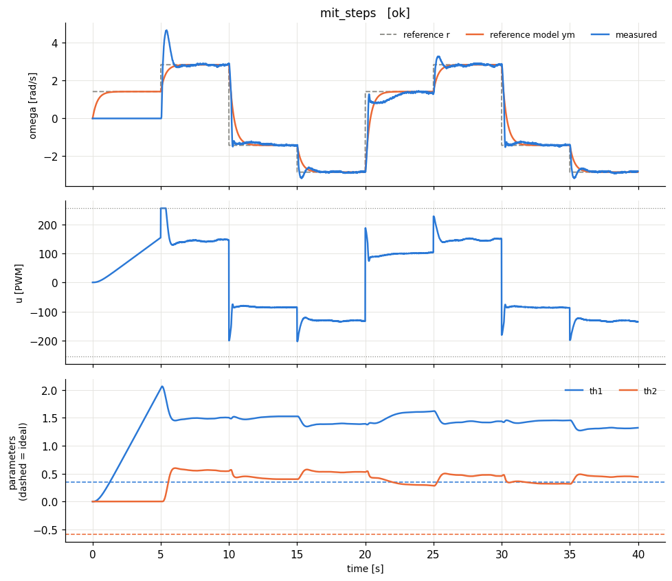
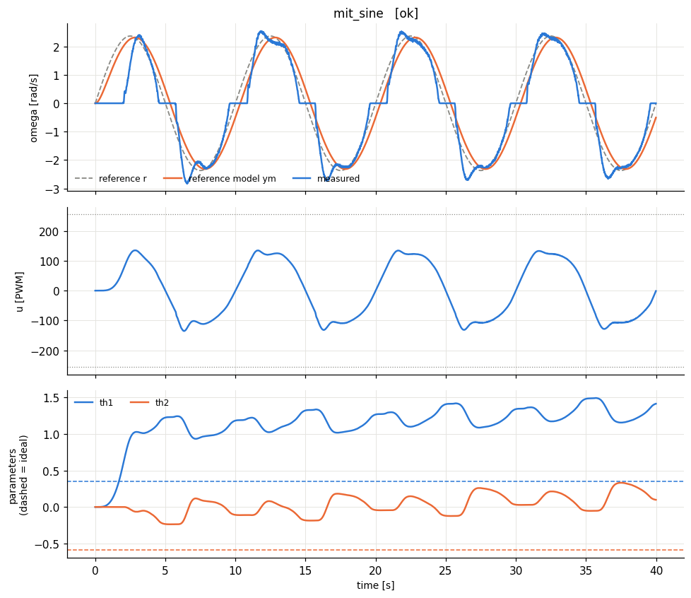
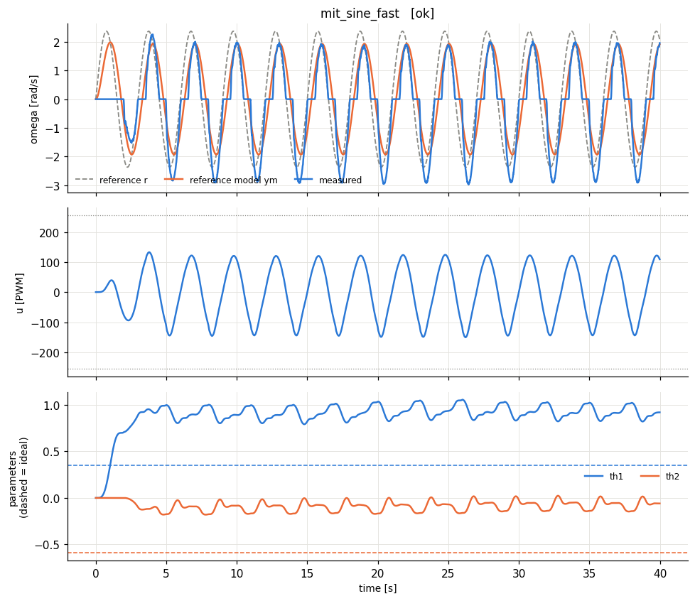
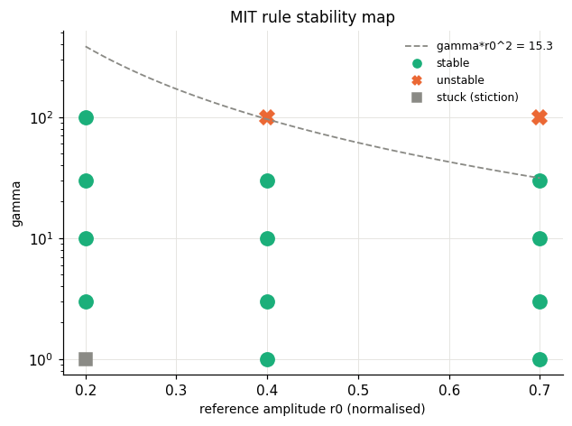

# lab2_mit - HARDWARE run 20261014_143203

## Design

Identified model: tau = 0.128 s (a = 7.84 1/s), K = 0.0198 rad/s/PWM, dead zone ~ 11 PWM, omega_max = 4.7 rad/s.

Normalised plant: dy/dt = -7.84 y + 8.35 u_n   (y = omega/4.7, u_n = u/255).

Reference model: dym/dt = -2.9 ym + 2.9 r  (time constant 0.345 s; open loop 0.128 s, dead time 0.115 s).

MIT rule, gamma = 5.0. Ideal parameters: th1* = bm/b = 0.347, th2* = (am - a)/b = -0.592.

## 1. Tracking with the MIT rule

| experiment | verdict | RMS e (norm) | RMS e last 25% | PE level | param drift (2nd half) | final params (ideal) |
|---|---|---|---|---|---|---|
| mit_steps | poor tracking | 0.127 | 0.0707 | 0.00358 | 0.35 | th1=1.32 (0.347), th2=0.44 (-0.592) |
| mit_sine | poor tracking | 0.122 | 0.103 | 0.00636 | 0.455 | th1=1.41 (0.347), th2=0.0983 (-0.592) |
| mit_sine_fast | poor tracking | 0.137 | 0.124 | 0.0731 | 0.236 | th1=0.921 (0.347), th2=-0.0595 (-0.592) |

**How to read the table.** *RMS e* is the normalised tracking error y - ym (0.01 = 1 % of omega_max). *PE level* = worst-case lambda_min/lambda_max of the windowed regressor covariance (≈0: not persistently exciting -> parameters need not converge to the ideal values; > ~0.01: PE holds -> parameters should approach the dashed ideal lines). *param drift* = largest parameter change during the second half of the run (large on a constant reference = parameter drift, the precursor of bursting/instability).

## 2. Stability map: gamma x reference amplitude

| gamma | r0 (norm) | gamma*r0^2 | RMS e last 25% | verdict | status |
|---|---|---|---|---|---|
| 1 | 0.2 | 0.04 | 0.188 | STUCK (stiction) | ok |
| 1 | 0.4 | 0.16 | 0.0814 | stable | ok |
| 1 | 0.7 | 0.49 | 0.0835 | stable | ok |
| 3 | 0.2 | 0.12 | 0.0597 | stable | ok |
| 3 | 0.4 | 0.48 | 0.0679 | stable | ok |
| 3 | 0.7 | 1.47 | 0.0751 | stable | ok |
| 10 | 0.2 | 0.4 | 0.0604 | stable | ok |
| 10 | 0.4 | 1.6 | 0.0494 | stable | ok |
| 10 | 0.7 | 4.9 | 0.0692 | stable | ok |
| 30 | 0.2 | 1.2 | 0.0548 | stable | ok |
| 30 | 0.4 | 4.8 | 0.0475 | stable | ok |
| 30 | 0.7 | 14.7 | 0.104 | stable | ok |
| 100 | 0.2 | 4 | 0.0565 | stable | ok |
| 100 | 0.4 | 16 | 0.368 | UNSTABLE | ABORTED: adaptive parameters diverged at t=10.1s |
| 100 | 0.7 | 49 | 0.652 | UNSTABLE | ABORTED: adaptive parameters diverged at t=0.9s |

**Observed condition:** every stable run has gamma*r0^2 <= 14.7 and every unstable run gamma*r0^2 >= 16: a single threshold on gamma*r0^2 separates them, confirming the MIT-rule condition gamma*r0^2 < c with c in that interval.

