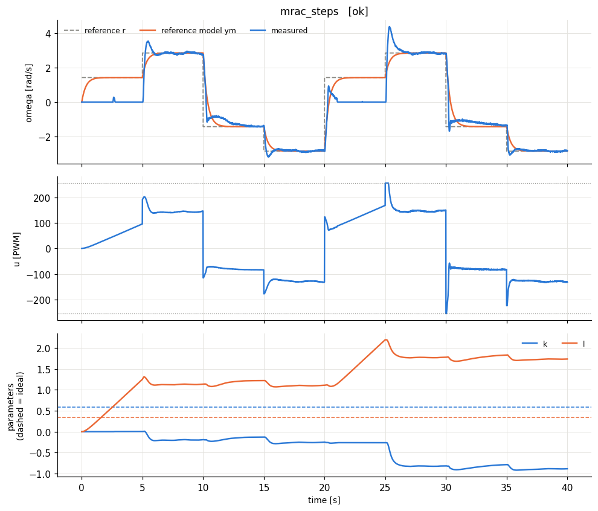
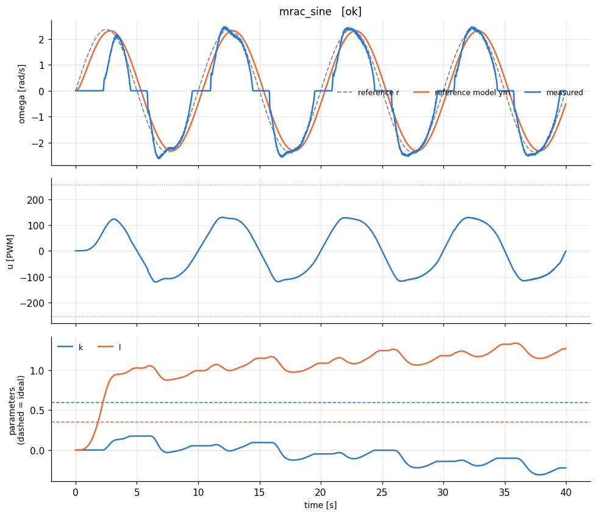
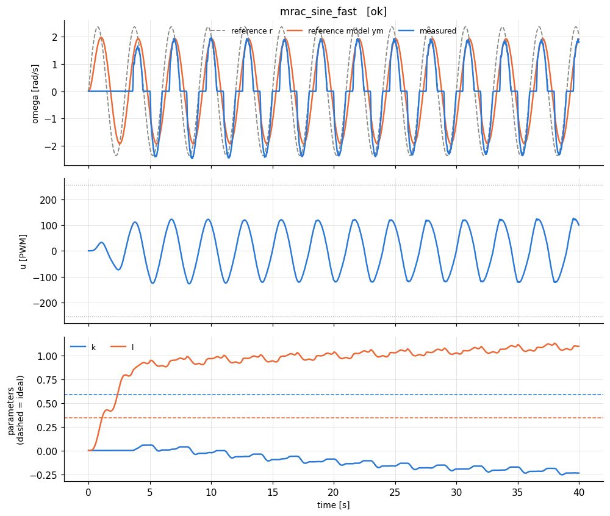
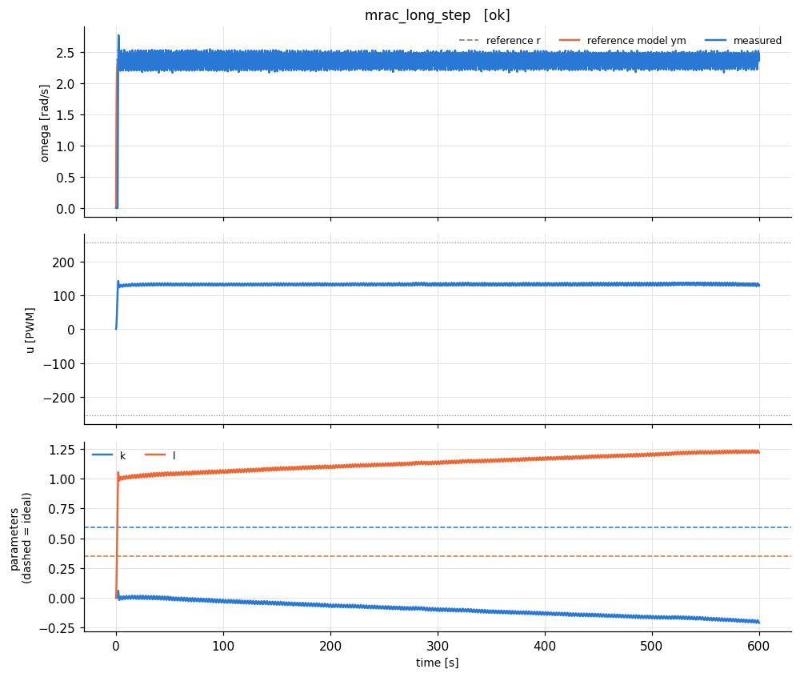

# lab3_mrac - HARDWARE run 20261014_144115

## Design

Identified model: tau = 0.128 s (a = 7.84 1/s), K = 0.0198 rad/s/PWM, dead zone ~ 11 PWM, omega_max = 4.7 rad/s.

Normalised plant: dy/dt = -7.84 y + 8.35 u_n   (y = omega/4.7, u_n = u/255).

Reference model: dym/dt = -2.9 ym + 2.9 r  (time constant 0.345 s; open loop 0.128 s, dead time 0.115 s).

Scalar MRAC, gamma = 3.0. Matching conditions: -a + b k* = -am, b l* = bm  ->  k* = 0.592, l* = 0.347. Initial estimates: 0.

## Experiments

| experiment | verdict | RMS e (norm) | RMS e last 25% | PE level | param drift (2nd half) | final params (ideal) |
|---|---|---|---|---|---|---|
| mrac_steps | poor tracking | 0.154 | 0.0701 | 0.0147 | 1.11 | k=-0.887 (0.592), l=1.74 (0.347) |
| mrac_sine | poor tracking | 0.124 | 0.099 | 0.0146 | 0.308 | k=-0.224 (0.592), l=1.27 (0.347) |
| mrac_sine_fast | poor tracking | 0.139 | 0.118 | 0.0725 | 0.166 | k=-0.237 (0.592), l=1.1 (0.347) |
| mrac_long_step | OK | 0.0269 | 0.0145 | 0.000195 | 0.124 | k=-0.21 (0.592), l=1.22 (0.347) |

**How to read the table.** *RMS e* is the normalised tracking error y - ym (0.01 = 1 % of omega_max). *PE level* = worst-case lambda_min/lambda_max of the windowed regressor covariance (≈0: not persistently exciting -> parameters need not converge to the ideal values; > ~0.01: PE holds -> parameters should approach the dashed ideal lines). *param drift* = largest parameter change during the second half of the run (large on a constant reference = parameter drift, the precursor of bursting/instability).

**Expected:** with steps the regressor w = [y, r] becomes collinear (y -> r) so PE fails and (k, l) settle on *some* point of the line k*y + l*r = matching value, not necessarily (k*, l*). One sinusoid is sufficiently rich for 2 parameters, but the SLOW sine (period >> 1/am) keeps y ~ r, so PE is weak; the faster sine (FAST_SINE_PERIOD) separates y from r, the PE level rises and (k, l) should approach the ideal values (up to the first-order model error and the dead zone). On the long step, watch the drift column: no PE + noise can make the estimates wander.
