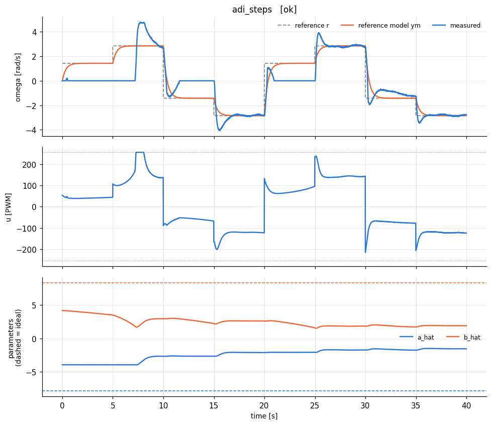
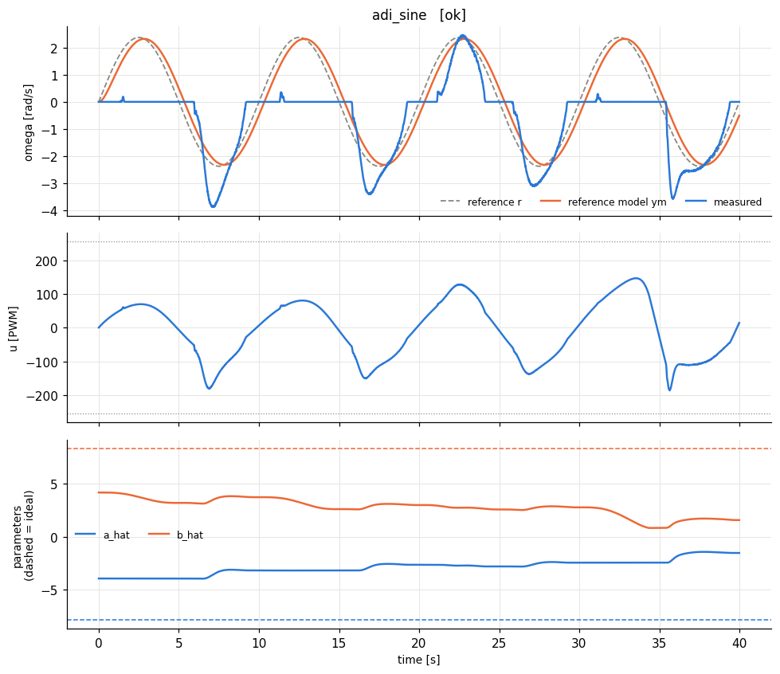
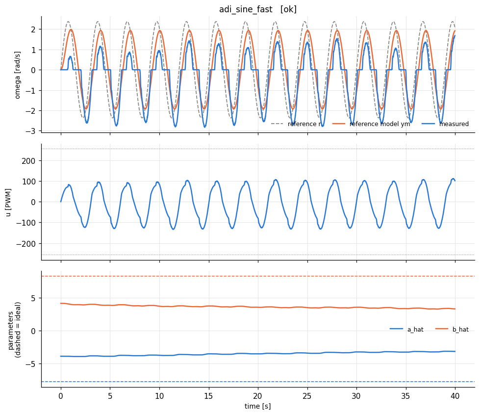
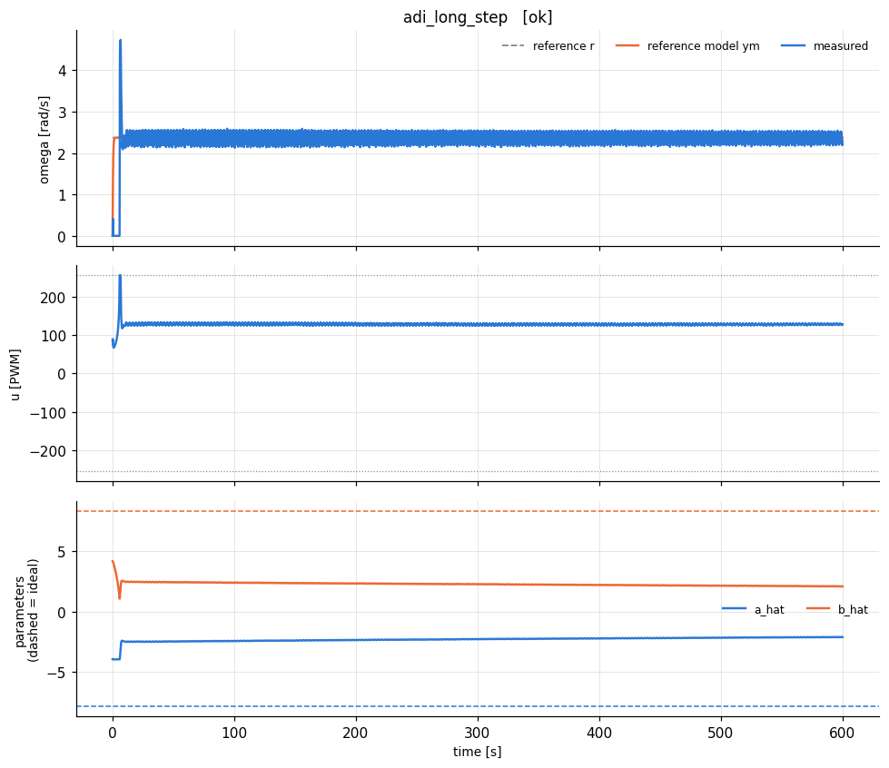

# lab4_adi - HARDWARE run 20261014_145549

## Design

Identified model: tau = 0.128 s (a = 7.84 1/s), K = 0.0198 rad/s/PWM, dead zone ~ 11 PWM, omega_max = 4.7 rad/s.

Normalised plant: dy/dt = -7.84 y + 8.35 u_n   (y = omega/4.7, u_n = u/255).

Reference model: dym/dt = -2.9 ym + 2.9 r  (time constant 0.345 s; open loop 0.128 s, dead time 0.115 s).

ADI, gamma = 3.0, ke = 2.0. Ideal: a_hat* = -a = -7.84, b_hat* = 8.35. Initial: -3.92, 4.17; projection b_hat >= 0.835.

Error dynamics de/dt = -ke*e + (estimation errors)*regressor, so the error decays at rate ke independently of the reference model.

## Experiments

| experiment | verdict | RMS e (norm) | RMS e last 25% | PE level | param drift (2nd half) | final params (ideal) |
|---|---|---|---|---|---|---|
| adi_steps | poor tracking | 0.234 | 0.105 | 0.0524 | 1.13 | a_hat=-1.54 (-7.84), b_hat=1.9 (8.35) |
| adi_sine | poor tracking | 0.255 | 0.292 | 0.037 | 2.16 | a_hat=-1.52 (-7.84), b_hat=1.58 (8.35) |
| adi_sine_fast | poor tracking | 0.154 | 0.143 | 0.0925 | 0.402 | a_hat=-3.19 (-7.84), b_hat=3.33 (8.35) |
| adi_long_step | OK | 0.0551 | 0.02 | 0.000345 | 0.212 | a_hat=-2.1 (-7.84), b_hat=2.09 (8.35) |

**How to read the table.** *RMS e* is the normalised tracking error y - ym (0.01 = 1 % of omega_max). *PE level* = worst-case lambda_min/lambda_max of the windowed regressor covariance (≈0: not persistently exciting -> parameters need not converge to the ideal values; > ~0.01: PE holds -> parameters should approach the dashed ideal lines). *param drift* = largest parameter change during the second half of the run (large on a constant reference = parameter drift, the precursor of bursting/instability).

**Expected:** on constant references the regressor [y, u] is collinear -> no PE, estimates stop wherever a_hat*y + b_hat*u matches the true dynamics. The slow sine excites weakly, the fast sine clearly (compare the PE levels), so (a_hat, b_hat) should move toward (-a, b) mainly on sine_fast. Compare with Lab I.3: ADI identifies the plant (indirect), MRAC identifies the controller (direct).
