# lab6_angle - HARDWARE run 20261014_161617

## Design

Plant: theta' = omega, omega' = -7.84 omega + 6.3 u_n   (angles normalised by 6.28 rad, u_n = u/255).

Reference model: wn = 1.5 rad/s, zeta = 1 (settling ~ 2.7 s).

Matching: A + B k*^T = Am ->  k1* = -0.357, k2* = 0.769, l* = 0.357. gamma = 5.0, initial estimates 0. Dead-zone inverse at the output: u0 = 67.4 PWM (= measured stop threshold; near standstill the ideal linear gains ask for only a few PWM, which stick-slip friction would swallow). wn is limited by the motor speed and the dead time.

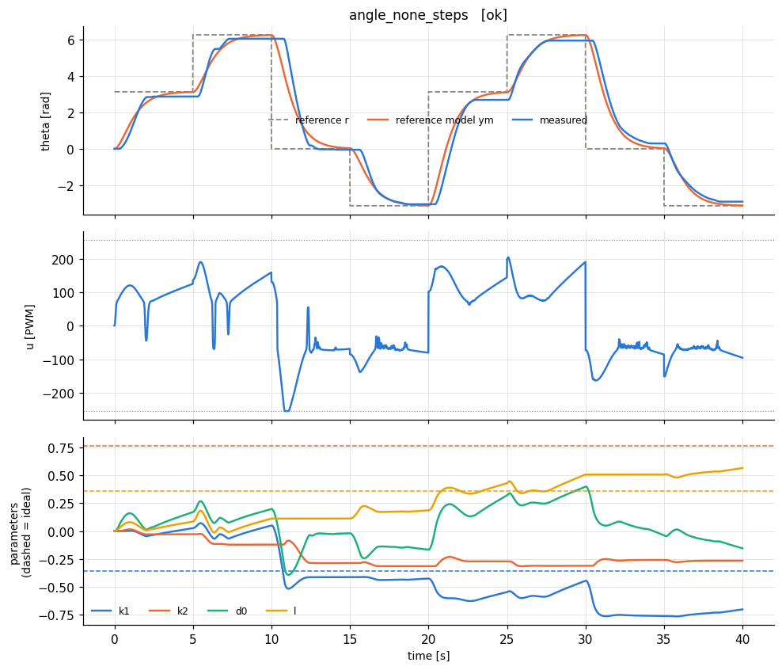

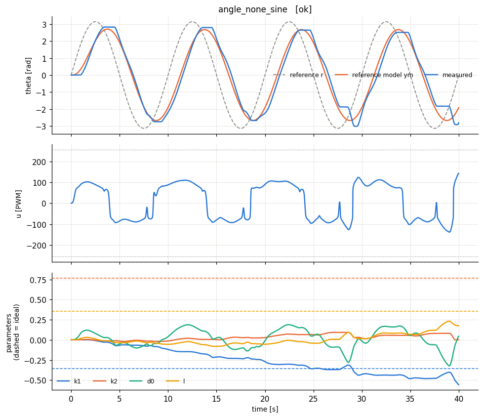

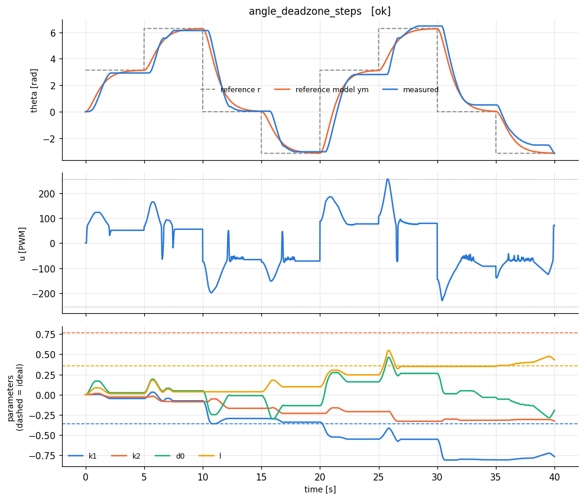

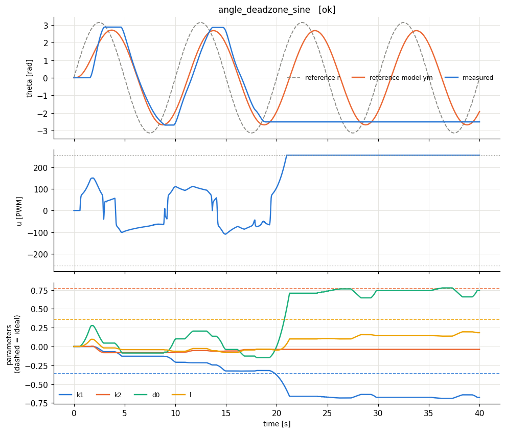

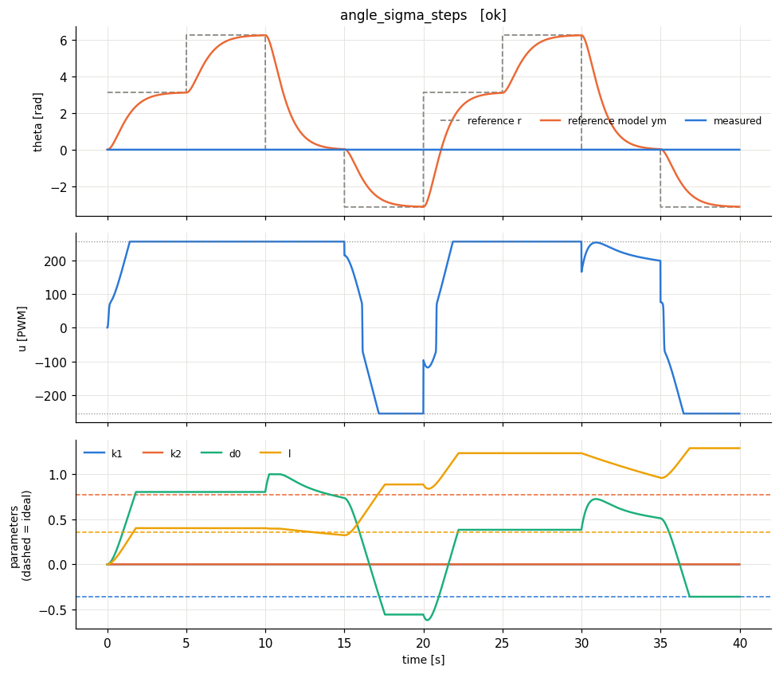

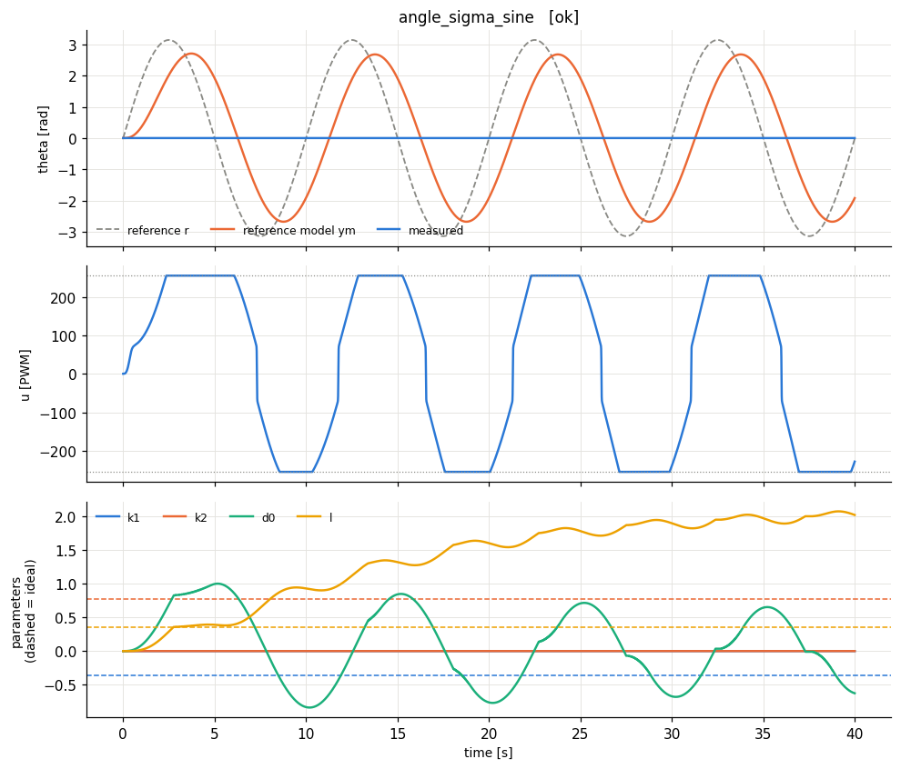

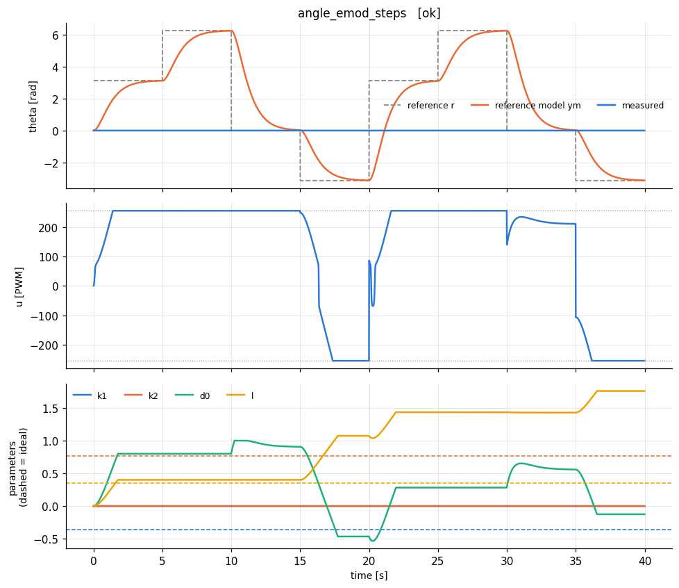

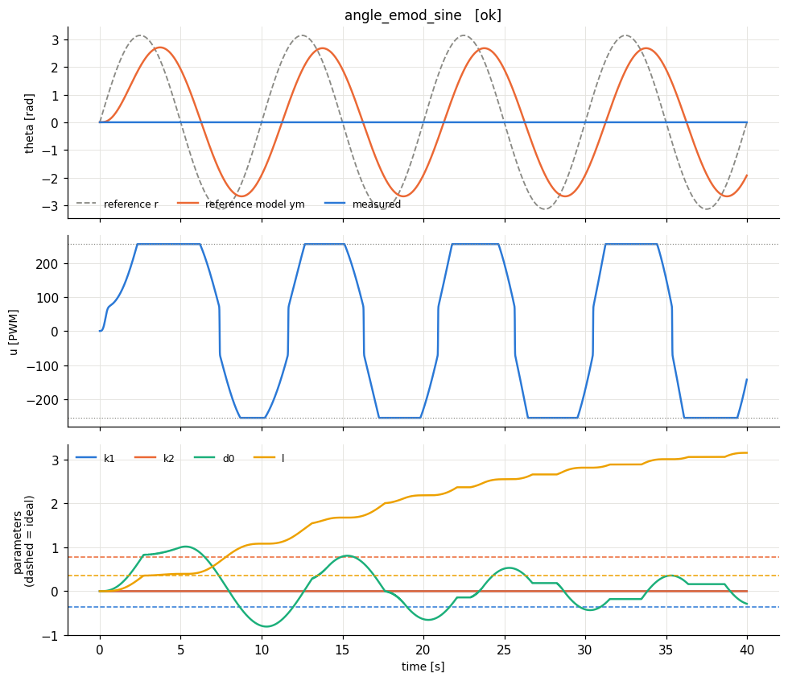

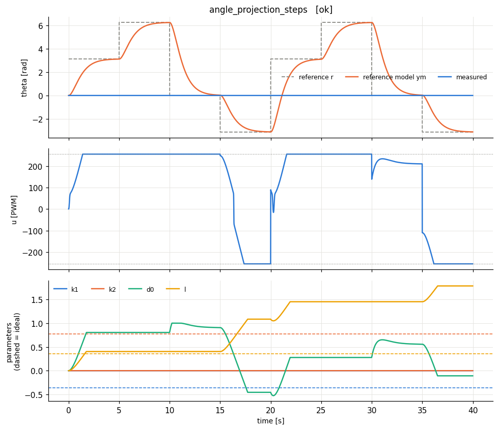

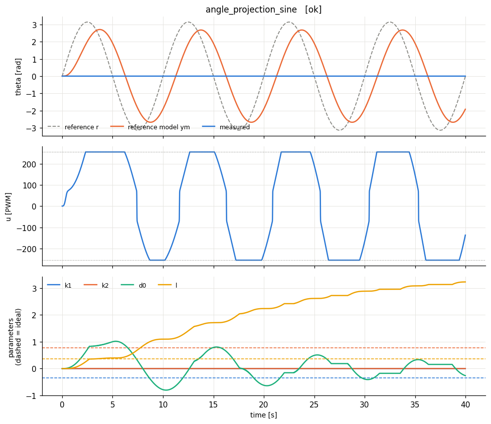

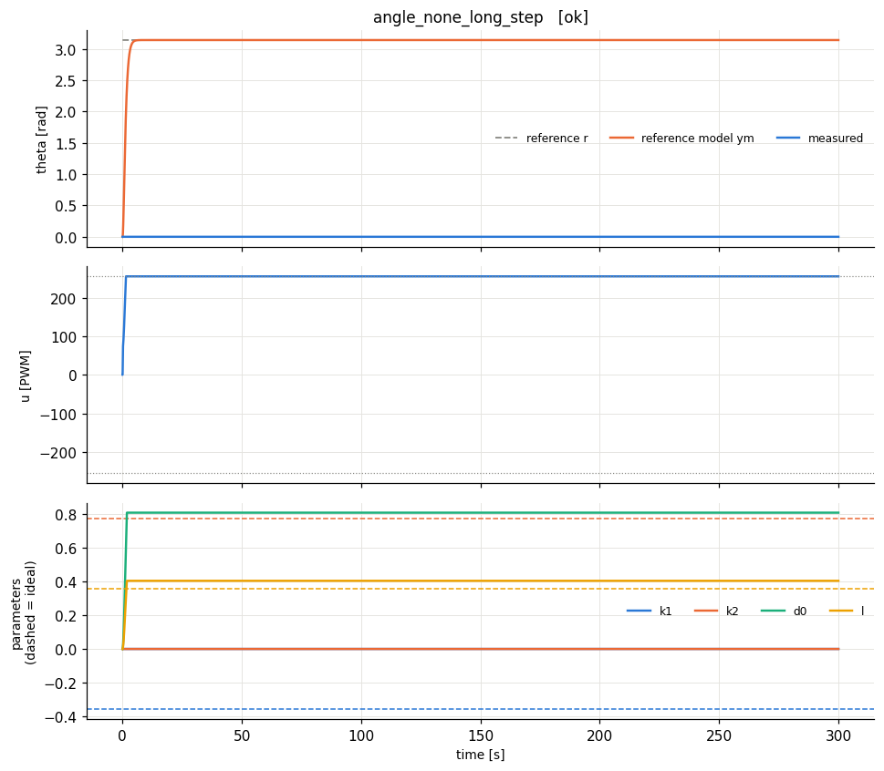

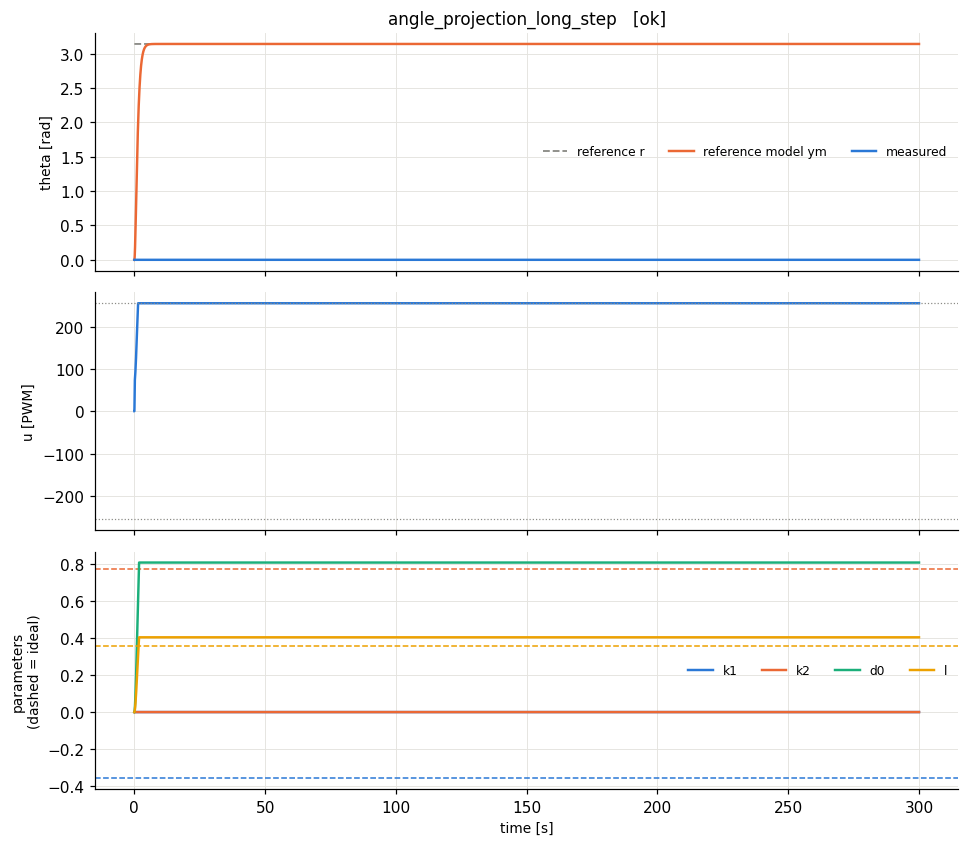

## Results

| experiment | verdict | RMS e (norm) | RMS e last 25% | PE level | param drift (2nd half) | final params (ideal) |
|---|---|---|---|---|---|---|
| angle_none_steps | OK | 0.0348 | 0.0268 | 0.00408 | 0.566 | k1=-0.703 (-0.357), k2=-0.265 (0.769), d0=-0.155, l=0.567 (0.357) |
| angle_none_sine | OK | 0.0248 | 0.0338 | 0.00132 | 0.512 | k1=-0.556 (-0.357), k2=0.00324 (0.769), d0=0.0457, l=0.176 (0.357) |
| angle_deadzone_steps | OK | 0.0347 | 0.0296 | 0.00481 | 0.745 | k1=-0.766 (-0.357), k2=-0.326 (0.769), d0=-0.194, l=0.43 (0.357) |
| angle_deadzone_sine | poor tracking | 0.0869 | 0.12 | -2.63e-15 | 0.772 | k1=-0.675 (-0.357), k2=-0.0383 (0.769), d0=0.744, l=0.183 (0.357) |
| angle_sigma_steps | poor tracking | 0.135 | 0.0822 | 0 | 1.35 | k1=0 (-0.357), k2=0 (0.769), d0=-0.36, l=1.29 (0.357) |
| angle_sigma_sine | poor tracking | 0.0807 | 0.0809 | 0 | 1.48 | k1=0 (-0.357), k2=0 (0.769), d0=-0.625, l=2.02 (0.357) |
| angle_emod_steps | poor tracking | 0.135 | 0.0822 | 0 | 1.19 | k1=0 (-0.357), k2=0 (0.769), d0=-0.125, l=1.76 (0.357) |
| angle_emod_sine | poor tracking | 0.0807 | 0.0809 | 0 | 1.18 | k1=0 (-0.357), k2=0 (0.769), d0=-0.286, l=3.15 (0.357) |
| angle_projection_steps | poor tracking | 0.135 | 0.0822 | 0 | 1.18 | k1=0 (-0.357), k2=0 (0.769), d0=-0.109, l=1.79 (0.357) |
| angle_projection_sine | poor tracking | 0.0807 | 0.0809 | 0 | 1.15 | k1=0 (-0.357), k2=0 (0.769), d0=-0.263, l=3.23 (0.357) |
| angle_none_long_step | poor tracking | 0.111 | 0.111 | 0 | 0 | k1=0 (-0.357), k2=0 (0.769), d0=0.805, l=0.403 (0.357) |
| angle_projection_long_step | poor tracking | 0.111 | 0.111 | 0 | 0 | k1=0 (-0.357), k2=0 (0.769), d0=0.805, l=0.403 (0.357) |

**How to read the table.** *RMS e* is the normalised tracking error y - ym (0.01 = 1 % of omega_max). *PE level* = worst-case lambda_min/lambda_max of the windowed regressor covariance (≈0: not persistently exciting -> parameters need not converge to the ideal values; > ~0.01: PE holds -> parameters should approach the dashed ideal lines). *param drift* = largest parameter change during the second half of the run (large on a constant reference = parameter drift, the precursor of bursting/instability). Here e is the filtered error e^T P B0 (normalised).

**What to look for:** at standstill the motor dead zone causes a small steady angle error; without robustness the adaptive gains then keep integrating that error (drift, possible limit cycle). The deadzone modification stops this once the error is inside e0; projection bounds it.
