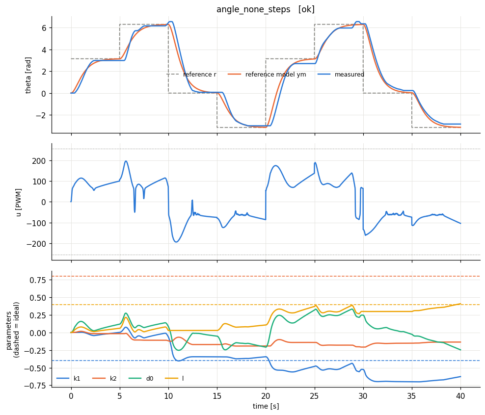
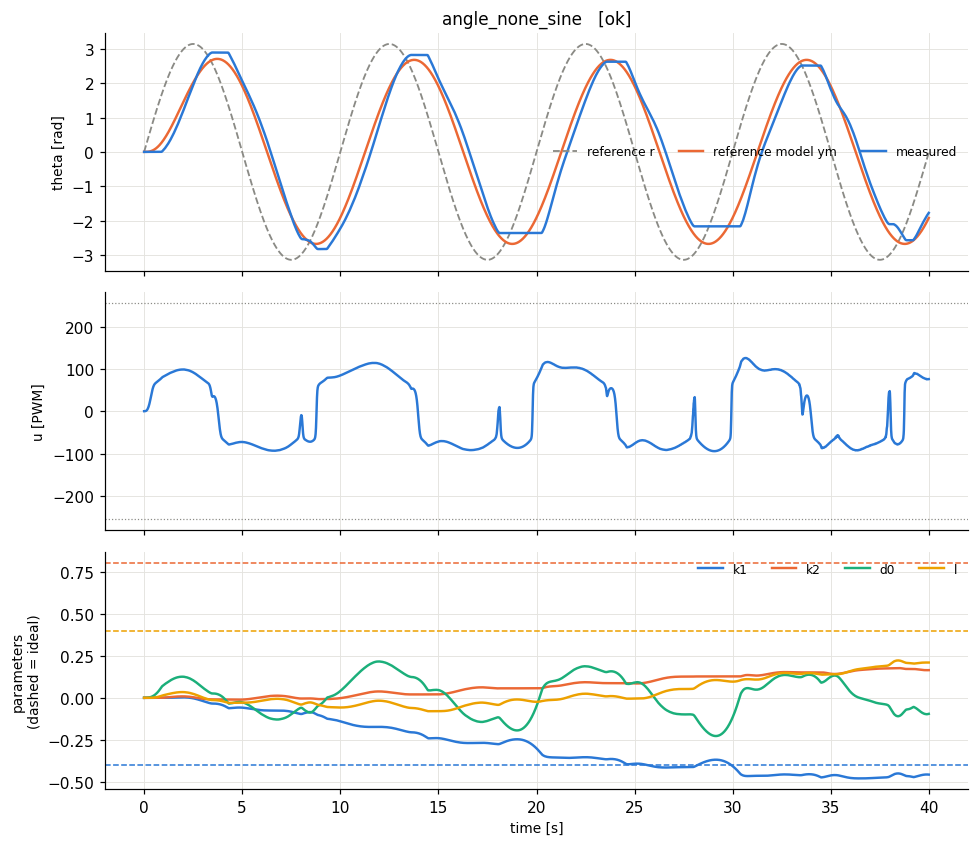
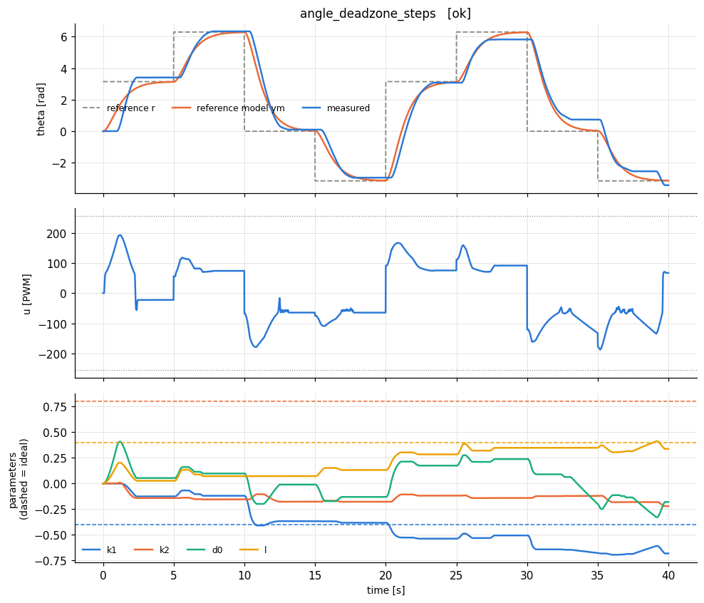
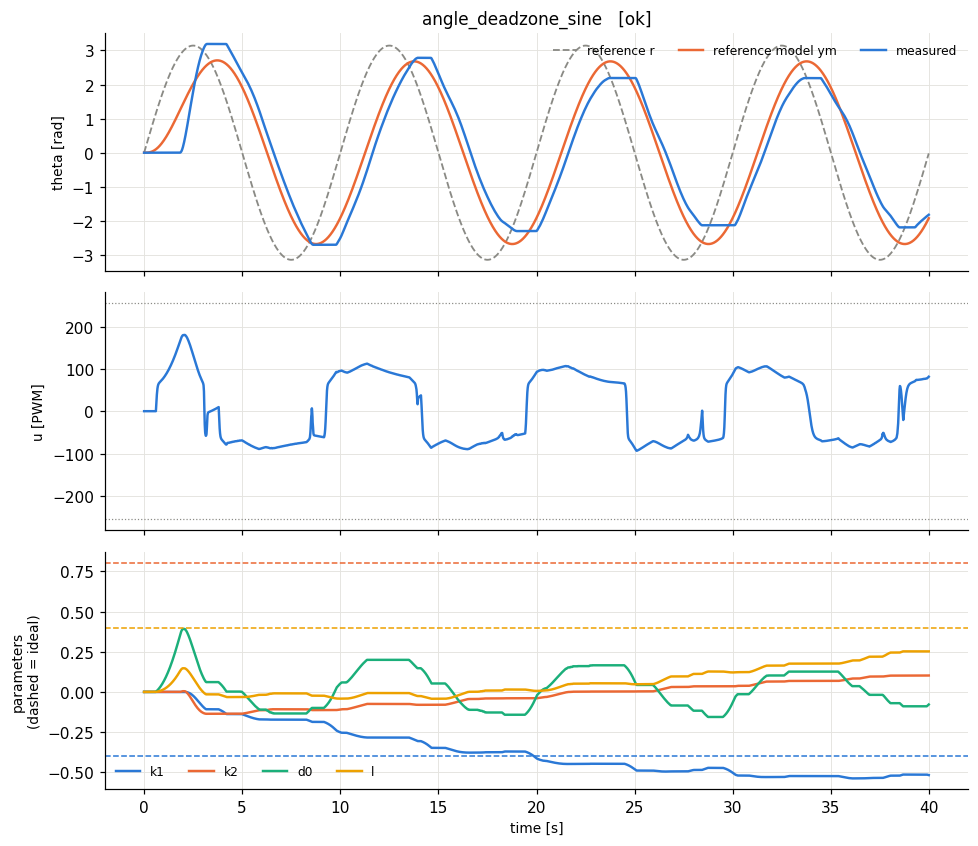
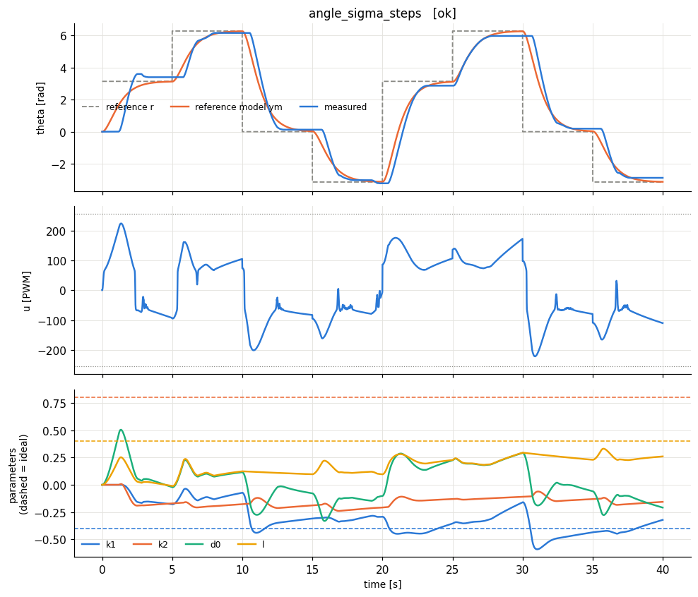
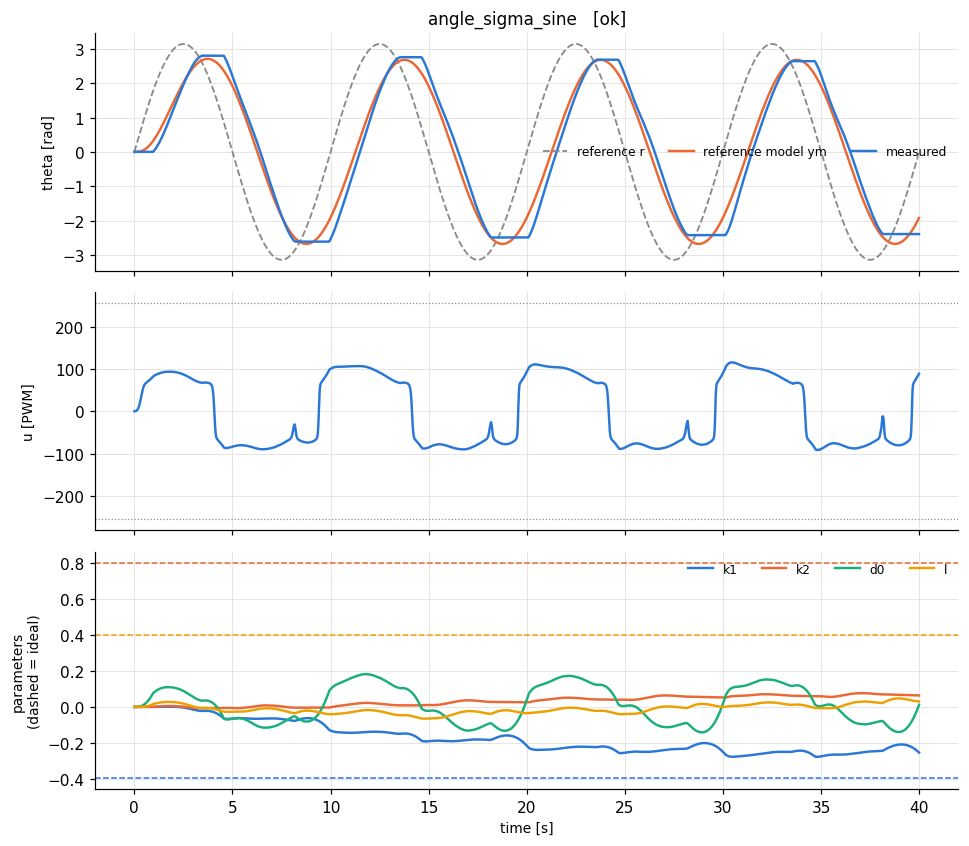
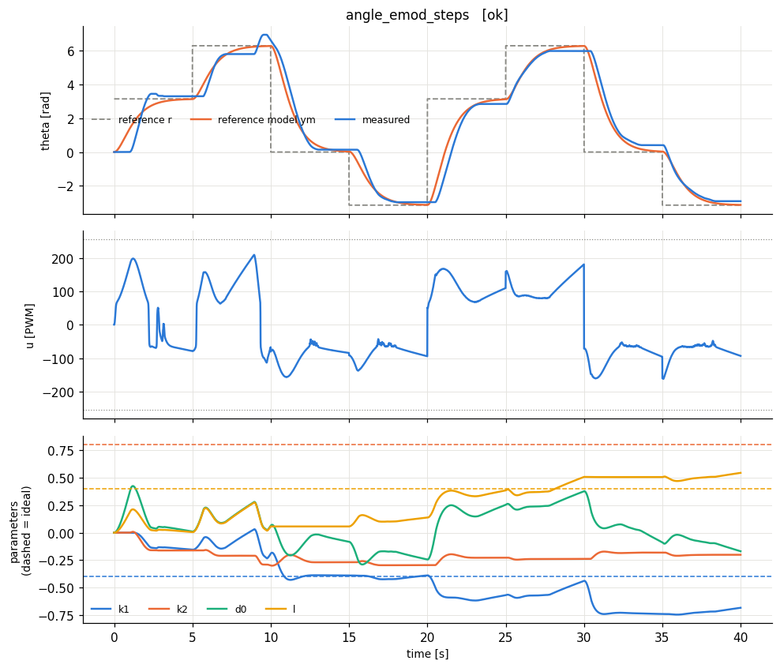
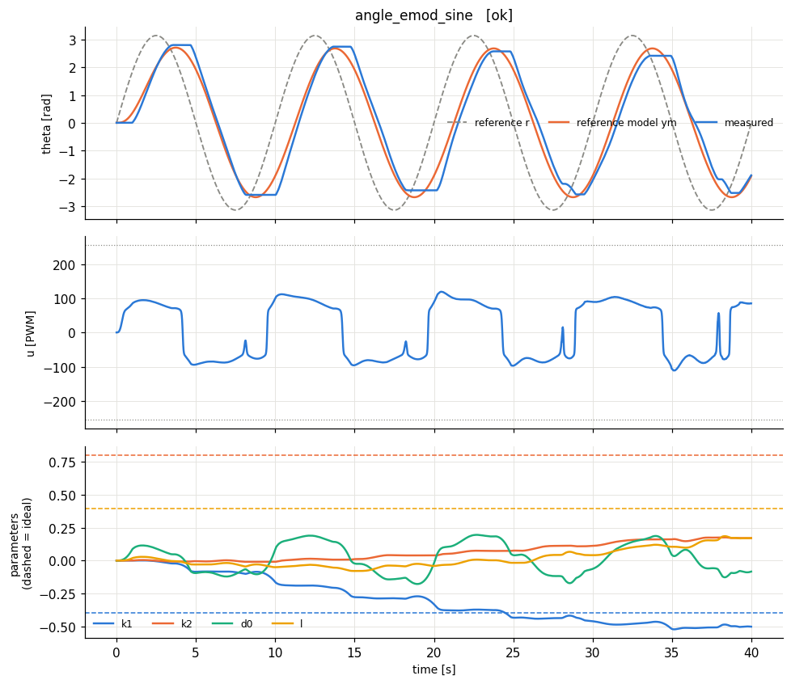
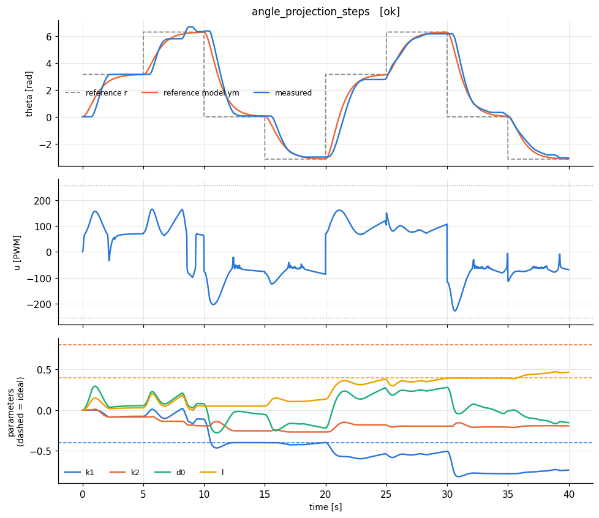

# lab6_angle - HARDWARE run 20261021_134413 (summary rebuilt from the saved runs)

**Incomplete:** the motor stopped responding at t = 15.3 s of angle_projection_sine (stall watchdog abort). Not run: angle_projection_sine, angle_none_long_step, angle_projection_long_step.

## Design

Plant: theta' = omega, omega' = -7.55 omega + 5.65 u_n (angles normalised by 6.28 rad). Model: results/rig/model.json identified 2026-10-21.

Reference model: wn = 1.5 rad/s, zeta = 1. Ideal: k1* = -0.398, k2* = 0.805, l* = 0.398. gamma = 5.0, dead-zone inverse u0 = 61.7 PWM.

## Results

| experiment | verdict | RMS e (norm) | RMS e last 25% | PE level | param drift (2nd half) | final params (ideal) |
|---|---|---|---|---|---|---|
| angle_none_steps | OK | 0.0285 | 0.0155 | 0.00464 | 0.58 | k1=-0.627 (-0.398), k2=-0.136 (0.805), d0=-0.246, l=0.409 (0.398) |
| angle_none_sine | OK | 0.0192 | 0.0206 | 0.00152 | 0.415 | k1=-0.456 (-0.398), k2=0.165 (0.805), d0=-0.0952, l=0.21 (0.398) |
| angle_deadzone_steps | OK | 0.0315 | 0.0293 | 0.00676 | 0.605 | k1=-0.683 (-0.398), k2=-0.221 (0.805), d0=-0.18, l=0.337 (0.398) |
| angle_deadzone_sine | OK | 0.0254 | 0.0188 | 0.00072 | 0.321 | k1=-0.517 (-0.398), k2=0.102 (0.805), d0=-0.0783, l=0.252 (0.398) |
| angle_sigma_steps | OK | 0.0402 | 0.0431 | 0.00723 | 0.57 | k1=-0.321 (-0.398), k2=-0.156 (0.805), d0=-0.209, l=0.26 (0.398) |
| angle_sigma_sine | OK | 0.0182 | 0.0189 | 0.00146 | 0.315 | k1=-0.254 (-0.398), k2=0.0642 (0.805), d0=0.0118, l=0.0306 (0.398) |
| angle_emod_steps | OK | 0.0345 | 0.0261 | 0.00708 | 0.621 | k1=-0.682 (-0.398), k2=-0.201 (0.805), d0=-0.169, l=0.544 (0.398) |
| angle_emod_sine | OK | 0.0191 | 0.0187 | 0.00163 | 0.368 | k1=-0.503 (-0.398), k2=0.171 (0.805), d0=-0.0838, l=0.17 (0.398) |
| angle_projection_steps | OK | 0.0324 | 0.0282 | 0.00577 | 0.5 | k1=-0.735 (-0.398), k2=-0.193 (0.805), d0=-0.154, l=0.464 (0.398) |

Angle error vs reference model (physical units):

| experiment | RMS e_theta last 25 % [rad] | max e_theta [rad] |
|---|---|---|
| angle_none_steps | 0.274 | 1.31 |
| angle_none_sine | 0.327 | 0.82 |
| angle_deadzone_steps | 0.422 | 1.42 |
| angle_deadzone_sine | 0.427 | 1.29 |
| angle_sigma_steps | 0.485 | 1.70 |
| angle_sigma_sine | 0.311 | 0.71 |
| angle_emod_steps | 0.343 | 1.45 |
| angle_emod_sine | 0.309 | 0.80 |
| angle_projection_steps | 0.331 | 1.24 |

**How to read the table.** *RMS e* is the normalised tracking error y - ym (0.01 = 1 % of omega_max). *PE level* = worst-case lambda_min/lambda_max of the windowed regressor covariance (≈0: not persistently exciting -> parameters need not converge to the ideal values; > ~0.01: PE holds -> parameters should approach the dashed ideal lines). *param drift* = largest parameter change during the second half of the run (large on a constant reference = parameter drift, the precursor of bursting/instability). Here e is the filtered error e^T P B0 (normalised).

