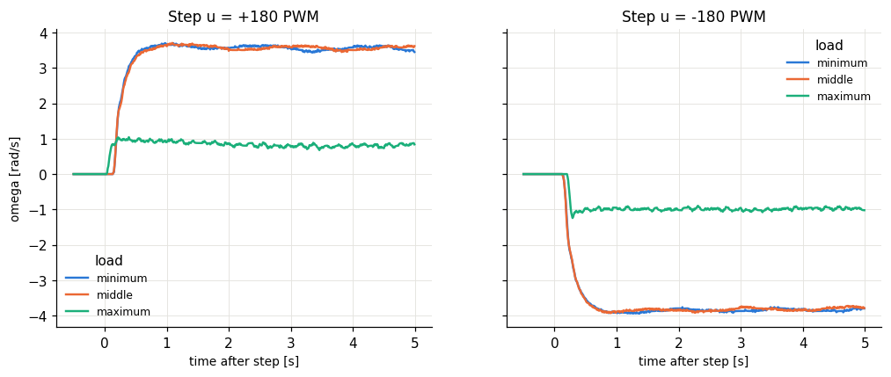

# Lab I.1 D - load potentiometer on the second motor

| load | u [PWM] | omega_ss [rad/s] | gain omega_ss/u | tau [s] | a = 1/tau | Td [s] | moved |
|---|---|---|---|---|---|---|---|
| minimum | 180 | 3.59 | 0.0199 | 0.135 | 7.41 | 0.145 | 2/2 |
| minimum | -180 | -3.84 | 0.0213 | 0.135 | 7.41 | 0.145 | 2/2 |
| middle | 180 | 3.55 | 0.0197 | 0.135 | 7.41 | 0.145 | 2/2 |
| middle | -180 | -3.78 | 0.021 | 0.125 | 8 | 0.15 | 2/2 |
| maximum | 180 | 0.801 | 0.00445 | 0.035 | 28.6 | 0.05 | 2/2 |
| maximum | -180 | -0.97 | 0.00539 | 0.045 | 22.2 | 0.125 | 2/2 |

More electrical load on the generator (lower resistance) = more braking torque: expect lower steady-state speed (smaller gain) and a faster pole a. The dead time / breakaway may also change.

## Significance check

- u = +180: spread between positions 2.786 rad/s, (78 %), repeat scatter 0.020 rad/s -> **SIGNIFICANT - the load changes the speed** (most braking = `maximum`)
- u = -180: spread between positions 2.867 rad/s, (75 %), repeat scatter 0.016 rad/s -> **SIGNIFICANT - the load changes the speed** (most braking = `maximum`)

If not significant: check that the second motor's terminals are actually connected through the potentiometer (an open circuit gives no braking) and that its resistance range is low enough compared with the motor's armature resistance to draw a noticeable current.
