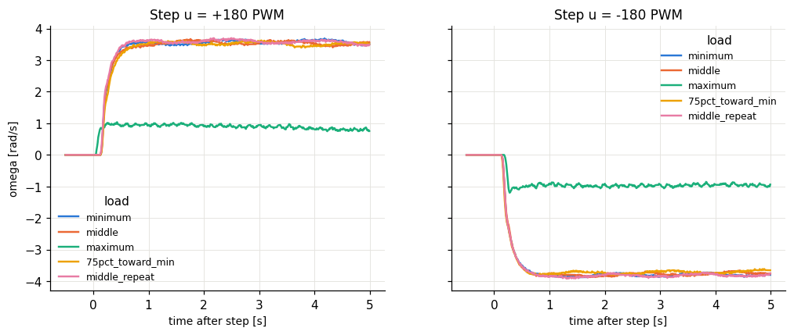

# Lab I.1 D - load potentiometer on the second motor

| load | u [PWM] | omega_ss [rad/s] | gain omega_ss/u | tau [s] | a = 1/tau | Td [s] | moved |
|---|---|---|---|---|---|---|---|
| minimum | 180 | 3.57 | 0.0198 | 0.125 | 8 | 0.145 | 2/2 |
| minimum | -180 | -3.79 | 0.021 | 0.12 | 8.33 | 0.145 | 2/2 |
| middle | 180 | 3.49 | 0.0194 | 0.12 | 8.33 | 0.135 | 2/2 |
| middle | -180 | -3.72 | 0.0207 | 0.125 | 8 | 0.145 | 2/2 |
| maximum | 180 | 0.834 | 0.00464 | 0.04 | 25 | 0.05 | 2/2 |
| maximum | -180 | -0.955 | 0.00531 | 0.045 | 22.2 | 0.12 | 2/2 |
| 75pct_toward_min | 180 | 3.49 | 0.0194 | 0.13 | 7.69 | 0.14 | 2/2 |
| 75pct_toward_min | -180 | -3.68 | 0.0204 | 0.12 | 8.33 | 0.14 | 2/2 |
| middle_repeat | 180 | 3.57 | 0.0198 | 0.115 | 8.7 | 0.135 | 2/2 |
| middle_repeat | -180 | -3.81 | 0.0212 | 0.125 | 8 | 0.15 | 2/2 |

More electrical load on the generator (lower resistance) = more braking torque: expect lower steady-state speed (smaller gain) and a faster pole a. The dead time / breakaway may also change.

## Significance check

- u = +180: spread between positions 2.739 rad/s, repeat scatter 0.023 rad/s -> **SIGNIFICANT - the load changes the speed** (most braking = `maximum` = maximum load)
- u = -180: spread between positions 2.858 rad/s, repeat scatter 0.013 rad/s -> **SIGNIFICANT - the load changes the speed** (most braking = `maximum` = maximum load)

If not significant: check that the second motor's terminals are actually connected through the potentiometer (an open circuit gives no braking) and that its resistance range is low enough compared with the motor's armature resistance to draw a noticeable current.
