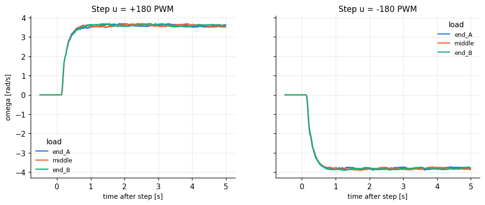

# Lab I.1 D - load potentiometer on the second motor

| load | u [PWM] | omega_ss [rad/s] | gain omega_ss/u | tau [s] | a = 1/tau | Td [s] | moved |
|---|---|---|---|---|---|---|---|
| end_A | 180 | 3.55 | 0.0197 | 0.125 | 8 | 0.145 | 2/2 |
| end_A | -180 | -3.77 | 0.021 | 0.135 | 7.41 | 0.14 | 2/2 |
| middle | 180 | 3.56 | 0.0198 | 0.135 | 7.41 | 0.145 | 2/2 |
| middle | -180 | -3.8 | 0.0211 | 0.14 | 7.14 | 0.145 | 2/2 |
| end_B | 180 | 3.59 | 0.02 | 0.145 | 6.9 | 0.145 | 2/2 |
| end_B | -180 | -3.8 | 0.0211 | 0.135 | 7.41 | 0.145 | 2/2 |

More electrical load on the generator (lower resistance) = more braking torque: expect lower steady-state speed (smaller gain) and a faster pole a. The dead time / breakaway may also change.

## Significance check

- u = +180: spread between positions 0.045 rad/s, repeat scatter 0.018 rad/s -> **NOT significant - the potentiometer has no measurable effect**
- u = -180: spread between positions 0.032 rad/s, repeat scatter 0.015 rad/s -> **NOT significant - the potentiometer has no measurable effect**

If not significant: check that the second motor's terminals are actually connected through the potentiometer (an open circuit gives no braking) and that its resistance range is low enough compared with the motor's armature resistance to draw a noticeable current.
